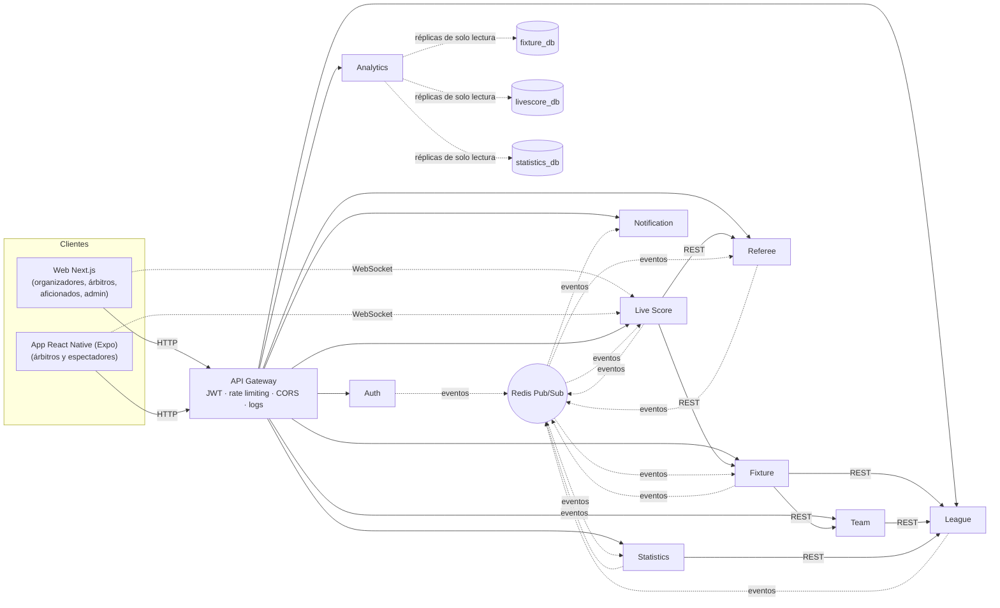
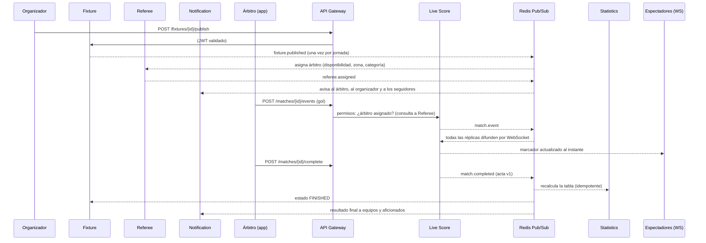

# SportsLeague

Plataforma de gestión de ligas deportivas amateur (fútbol, básquet y vóley) construida con
**microservicios independientes**: cada servicio tiene su propio código, su propia base de datos
PostgreSQL, su propio Dockerfile y su propio pipeline de CI/CD.

- **Organizadores**: crean su liga, temporadas, categorías y reglamento, canchas, equipos y
  jugadores, árbitros; generan el calendario automáticamente y controlan los partidos en vivo.
- **Administrador**: autoriza (o rechaza/suspende) las ligas, gestiona las cuentas y verifica
  que todo funcione: salud de cada microservicio, bus de eventos y trazabilidad por partido.
- **Árbitros**: ven y confirman sus partidos asignados y registran goles, tarjetas y cambios.
- **Aficionados**: siguen ligas, ven el marcador en tiempo real y reciben avisos.

---

## Inicio rápido

Único requisito: **Docker Desktop** (Windows/macOS) o Docker Engine con el plugin compose
(Linux). No hace falta instalar Node.js: todo se instala dentro de los contenedores.

**Windows** — doble clic en **`iniciar.bat`**. El script:

1. comprueba que Docker esté en ejecución (si no, abre Docker Desktop) y que los puertos estén libres;
2. construye las 11 imágenes de a pocas, reintentando si npm pierde la conexión
   (la primera vez tarda 10–20 minutos y necesita internet; después queda en caché);
3. arranca todo con `docker compose up -d` y espera a que la plataforma responda;
4. carga la liga de demostración y abre **http://localhost:3000**.

Para detener: **`detener.bat`** (los datos se conservan). Opciones desde PowerShell:
`.\iniciar.ps1 -SinDemo`, `-SinConstruir` (arranque rápido con las imágenes ya construidas), `-SinNavegador`.

**Linux / macOS**: `sh iniciar.sh` (admite `--sin-demo` y `--sin-construir`).

**Manual** (cualquier sistema):

```bash
docker compose up --build -d                  # plataforma + observabilidad
docker compose --profile demo run --rm seed   # liga de demostración (equivale a node scripts/seed-demo.mjs)
```

| Cuenta | Correo | Contraseña |
|---|---|---|
| Administrador | `admin@sportsleague.com` | `Admin12345` |
| Organizador (liga de demo) | `organizador@demo.com` | `Demo12345` |
| Organizadora (2 ligas pendientes) | `organizadora@demo.com` | `Demo12345` |
| Árbitro | `arbitro@demo.com` | `Demo12345` |
| Aficionado | `aficionado@demo.com` | `Demo12345` |

| URL | Qué es |
|---|---|
| http://localhost:3000 | Web (pública, panel de organizador/árbitro y administración) |
| http://localhost:4000 | API Gateway — único punto de entrada HTTP |
| http://localhost:4006 | Canal WebSocket del Live Score Service (espectadores) |
| http://localhost:3100 | Grafana (`admin` / `admin`) con el dashboard "Jornada en vivo" |
| http://localhost:9090 | Prometheus (métricas y alertas) |

Comandos útiles:

```bash
docker compose ps                          # estado de los contenedores (healthy = listo)
docker compose logs -f live-score-service  # logs JSON de un servicio
docker compose down                        # detener (conserva los datos)
docker compose down -v                     # detener y borrar las bases de datos
```

> El usuario administrador se crea automáticamente al iniciar el Auth Service con
> `ADMIN_EMAIL` / `ADMIN_PASSWORD` (ver `.env.example`). Cambia todos los secretos antes de
> desplegar en producción.

### Llevar el proyecto a otro equipo

1. Copia la carpeta completa (≈6 MB: no incluye `node_modules`, todo se instala dentro de Docker).
2. Déjala en una carpeta local, por ejemplo `C:\SportsLeague`. Evita carpetas sincronizadas
   (OneDrive, Dropbox): con "archivos a petición" la construcción puede fallar al leer archivos
   que todavía no se han descargado.
3. Instala **Docker Desktop**, ábrelo una vez y acepta los términos (en Windows, si lo pide,
   activa WSL 2 y reinicia). Espera a que indique *Engine running*.
4. Doble clic en `iniciar.bat`.

Equipo recomendado: Windows 10/11 de 64 bits, 8 GB de RAM (Docker con al menos 4 GB en
*Settings → Resources*), 10 GB libres en disco e internet en el primer arranque.

Verificado con Docker Desktop 4.91 (Compose v5.5) en Windows 11 con 8 GB de RAM: la primera
construcción tardó ≈11 minutos y el arranque completo con la demo ≈15; los siguientes arranques
(`.\iniciar.ps1 -SinConstruir`) tardan menos de 1 minuto y conservan los datos.

| Problema | Solución |
|---|---|
| `puerto 3000 ... ocupado` | Cierra el programa que lo usa o cambia el puerto de la izquierda en `docker-compose.yml` (p. ej. `"3001:3000"`). Si cambias el de la web, crea un `.env` (ver `.env.example`) con `CORS_ORIGINS` y `WS_ALLOWED_ORIGINS` apuntando a la nueva URL |
| El script dice *Abre Docker Desktop y espera...* y no lo abre solo | `iniciar.ps1` busca Docker Desktop en `C:\Program Files\Docker\Docker` y en `%LOCALAPPDATA%\Programs\DockerDesktop` (instalación solo para el usuario actual). Si está en otra ruta, ábrelo a mano: el script espera hasta 4 minutos a que el motor responda |
| `ETIMEDOUT` / `ECONNRESET` al construir | Red inestable: vuelve a ejecutar `iniciar.bat`; lo ya construido queda en caché |
| Docker no responde o los contenedores se quedan en *Created* | Docker Desktop → *Troubleshoot* → *Restart* (o reinicia el equipo) y vuelve a ejecutar |
| La web abre pero no hay ligas | `docker compose --profile demo run --rm seed` |
| El inicio de sesión falla al entrar por `http://127.0.0.1:3000` | Usa `http://localhost:3000`: es el origen permitido por CORS |
| En Grafana, el panel *Rate limiting (429) y circuit breakers abiertos* dice *No data* | Es normal: solo muestra series cuando el gateway rechaza solicitudes o se abre un circuito |
| No llegan las notificaciones push | Comprueba que el navegador tenga permiso (candado de la barra de direcciones → Notificaciones → Permitir), que el sistema operativo no las silencie (modo *No molestar*) y que el servicio tenga `VAPID_PUBLIC_KEY` y `VAPID_PRIVATE_KEY`. Si se cambiaron las claves, pulsa *Desactivar* y luego *Activar* |
| No llegan correos | Sin `MAIL_RELAY_URL` quedan simulados (ver [Correo real con Gmail](#correo-real-con-gmail)). Las cuentas `@demo.com`, `@example.com` y `@sportsleague.com` nunca reciben correo. Si en *Administración* el envío aparece como `FAILED`, revisa que `MAIL_RELAY_SECRET` coincida con `SECRETO` del script y que el script esté implementado con acceso para «Cualquier usuario» |
| Empezar de cero | `docker compose down -v` y luego `iniciar.bat` |

### Recorrido sugerido para la demostración

1. Entra como **organizadora@demo.com** → *Mis ligas* → crea una liga: queda **pendiente**.
2. Entra como **admin** → *Administración → Ligas*: apruébala. La organizadora recibe la notificación.
3. Como organizadora configura temporada, categoría, canchas, equipos (prueba un jugador
   menor de la edad mínima: queda *No elegible*), árbitros → *Calendario → Generar borrador → Publicar*.
4. En *Árbitros* verás las asignaciones automáticas; con **arbitro@demo.com** confírmalas.
5. Abre un partido en dos ventanas: una como espectador (`/partidos/<id>`) y otra en
   *Control en vivo*. Cada gol aparece al instante en la otra ventana (WebSocket).
6. Finaliza el partido: la tabla de posiciones se recalcula sola.
7. Como **admin** revisa *Sistema* (los 10 servicios, canales de eventos, ETL), *Eventos*
   (bus de Redis en tiempo real) y *Trazabilidad* (todo el ciclo de vida de un partido).

### App móvil (React Native)

`mobile/` es la app de árbitros y espectadores del documento de arquitectura, hecha con Expo:
el espectador sigue los partidos en vivo y los próximos sin iniciar sesión (marcador por WebSocket,
canal `/live-scores`), y el árbitro ve y confirma sus partidos y registra goles, tarjetas y cambios.
Por defecto usa la producción, así que basta con un teléfono con **Expo Go**:

```bash
cd mobile
npm install
npx expo start      # escanea el QR con Expo Go
```

Para usarla con la pila local, ver `mobile/README.md` (la IP del PC en lugar de `localhost`).

---

## Arquitectura



Cada microservicio tiene **su propia base de datos** (`auth_db`, `league_db`, `team_db`,
`fixture_db`, `referee_db`, `livescore_db`, `statistics_db`, `notification_db`,
`analytics_db`) con **su propio usuario de PostgreSQL**; ningún servicio puede conectarse a la
base de otro (`REVOKE ... FROM PUBLIC`). El Analytics Service lee las bases operativas solo a
través del usuario `analytics_ro` (permisos `SELECT`, transacciones de solo lectura), que
simula las réplicas de lectura del documento.

### Microservicios

| Servicio | Puerto | Responsabilidad | Llama por REST a | Publica | Consume |
|---|---|---|---|---|---|
| **API Gateway** | 4000 | Enrutamiento, validación de JWT, bloqueo de cuentas suspendidas, rate limiting, CORS, logs, salud agregada | todos | — | — |
| **Auth** *(nuevo)* | 4001 | Cuentas, roles, contraseñas (bcrypt), access + refresh tokens rotativos | — | `user.registered`, `user.updated` | — |
| **League** | 4002 | Ligas (aprobación del admin), temporadas, categorías, reglamento, canchas | — | `league.created`, `league.reviewed`, `rules.updated` | — |
| **Team** | 4003 | Equipos, plantillas, elegibilidad automática por edad | League | — | — |
| **Fixture** | 4004 | Generación del calendario, partidos manuales, reprogramaciones, suspensiones | League, Team | `fixture.published` (por jornada), `match.rescheduled`, `match.suspended` | `match.started`, `match.completed` |
| **Referee** | 4005 | Árbitros, disponibilidad, asignación automática | — | `referee.assigned`, `referee.unassigned` | `fixture.published`, `match.rescheduled`, `match.suspended`, `match.completed` |
| **Live Score** | 4006 | Eventos en vivo (REST) y difusión por WebSocket, actas versionadas | Fixture, Referee, Team | `match.started`, `match.event`, `match.event.deleted`, `match.completed` | `match.suspended` (+ sus propios eventos para difundirlos) |
| **Statistics** | 4007 | Tabla de posiciones, goleadores, disciplina (recálculo idempotente, caché Redis) | League, Live Score | `standings.updated` | `match.completed`, `fixture.published`, `rules.updated`, `match.event` |
| **Notification** | 4008 | Bandeja de notificaciones, seguidores de ligas, correo real con Gmail y push real en el navegador (Web Push) | Team | — | `league.*`, `user.registered`, `fixture.published`, `referee.*`, `match.rescheduled`, `match.suspended`, `match.completed` |
| **Analytics** | 4009 | ETL periódico: asistencia estimada, partidos suspendidos, tendencia de rendimiento, KPIs | — (réplicas de solo lectura) | — | — |

### Flujo completo de un partido



### Decisiones de comunicación

- **REST síncrono** solo donde se necesita una respuesta inmediata: Fixture → League/Team al
  generar el calendario, Team → League para el rango de edad, Statistics → League para el
  reglamento, Live Score → Fixture al iniciar el partido y → Referee para validar permisos.
  Todas las llamadas usan el `ServiceClient` del chassis: **timeout**, **reintentos con backoff
  exponencial** (solo lecturas) y **circuit breaker** (5 fallos → abierto 15 s → semiabierto).
  Los estados de los circuitos se ven en *Administración → Sistema* y en Grafana.
- **Eventos asíncronos** (Redis Pub/Sub) para todo el flujo del partido. Se prioriza la baja
  latencia sobre la garantía de entrega, como define el documento; por eso:
  - los consumidores son **idempotentes** (asignaciones únicas por partido, notificaciones con
    `dedupeKey`, actas con `version`);
  - Statistics **recalcula desde las actas completas** (no suma incrementos) y ofrece
    *Recalcular* con reconciliación: vuelve a leer las actas oficiales del Live Score Service
    si se perdió algún `match.completed`;
  - las correcciones del acta tras el cierre republican `match.completed` con una versión nueva.
- **Saga**: no se usa (no hay transacciones de negocio compensables); se aplica consistencia
  eventual + recálculo idempotente.
- **Resiliencia en vivo**: si Team Service cae durante un partido, el registro de eventos no se
  bloquea (la plantilla se cachea al iniciar); si League Service cae al fichar, el jugador queda
  *pendiente* de validación y se puede revalidar luego.

### Microservice chassis

La carpeta [`chassis/`](chassis) contiene el código transversal (logs JSON, métricas
Prometheus, `/health` `/status` `/metrics`, guard de autenticación por cabeceras del gateway,
bus de eventos, caché, trazas por `match_id`, cliente REST resiliente, validación con mensajes
en español). **Se copia (vendoriza) dentro de cada servicio** en `src/chassis`: no es una
librería compartida en tiempo de ejecución, así cada servicio se construye y despliega solo.
Para propagar una mejora: `node scripts/sync-chassis.mjs`.

---

## Seguridad

| Medida | Implementación |
|---|---|
| Autenticación | JWT HS256 de 15 min firmado por Auth Service y validado por el gateway en cada solicitud |
| Refresh tokens | Opacos, guardados como hash SHA-256, **rotativos** con detección de reutilización (si se reusa uno revocado se cierran todas las sesiones); en la web viajan en cookie `httpOnly` `SameSite` con `Path=/api/v1/auth` |
| CSRF | El refresh por cookie exige el token anti-CSRF emitido al iniciar sesión (cabecera `X-CSRF-Token`) |
| Permisos diferenciados | Roles ADMIN / ORGANIZER / REFEREE / SPECTATOR; el organizador solo modifica sus ligas; **un árbitro solo registra eventos de los partidos que tiene asignados** (verificado contra Referee Service) |
| Suspensión inmediata | Al suspender una cuenta, el gateway la bloquea al instante (lista en Redis) aunque su JWT siga vigente |
| Red privada | Solo gateway, WebSocket y web publican puertos; cada servicio exige un token interno (`x-internal-token`) y el gateway elimina cabeceras de identidad falsificadas |
| Rate limiting | Ventana fija en Redis compartida entre réplicas: login/registro 20/min por IP, escrituras 300/min, lecturas 1200/min (configurable) |
| Contraseñas | bcrypt (10 rondas), mínimo 8 caracteres con letras y números; tiempo constante ante correos inexistentes |
| SQL injection | Prisma (consultas parametrizadas) + `ValidationPipe` con `whitelist` y `forbidNonWhitelisted` |
| XSS | React escapa todo el contenido dinámico; cabeceras `X-Content-Type-Options`, `X-Frame-Options`, Helmet en el gateway |
| CORS | El gateway rechaza orígenes no listados en `CORS_ORIGINS`; el WebSocket rechaza las webs que no están en `WS_ALLOWED_ORIGINS` (acepta la app móvil, que envía como origen el propio host del WebSocket) |
| Validación | DTOs con class-validator en todos los servicios (fechas, rangos de edad, minutos 0–200, horarios HH:MM...) |

---

## Observabilidad

- **Logs estructurados (JSON)** en todos los servicios con `requestId`, `userId` y `match_id`.
  El `x-request-id` se propaga entre servicios y eventos.
- **Trazabilidad completa por `match_id`**: todo log con `matchId` se replica en un Redis Stream
  (`trace:match:<id>`). *Administración → Trazabilidad* muestra el recorrido de un partido por
  todos los microservicios: publicación, asignación de árbitro, eventos en vivo, acta, recálculo
  de la tabla y notificaciones.
- **Prometheus**: métricas HTTP de cada servicio y del gateway, más las del dominio:
  `match_events_registered_total{type,league_id,season_id,category_id}` (eventos por minuto),
  `live_score_update_latency_seconds` (desde que el árbitro registra el evento hasta que se
  difunde por WebSocket), `live_viewers_total`, `standings_recalculations_total`,
  `referee_assignments_total`, `circuit_breaker_state`, `gateway_rate_limit_rejections_total`.
- **Grafana**: dashboard "SportsLeague — Jornada en vivo" con filtros por liga, temporada y categoría.
- **Alertas** (`infra/prometheus/alerts.yml`): servicio caído, tasa de errores, latencia del
  gateway, latencia del marcador en vivo, CPU alta en Live Score, circuito abierto.
- **Health checks**: `/health` (base de datos + Redis; Render lo usa para los rolling updates) y
  `/status` (detalle) en cada servicio; *Administración → Sistema* los agrega.

---

## Estructura del repositorio

```
chassis/                 plantilla del microservice chassis (se copia a cada servicio)
services/
  api-gateway/           cada servicio: src/, test/, prisma/ (schema + migraciones),
  auth-service/          Dockerfile, package.json, .env.example, eslint y tsconfig propios,
                         README.md, .gitignore, database/ (esquema, datos de ejemplo y respaldo)
                         y .github/workflows/ci.yml para su repositorio independiente
  league-service/
  team-service/
  fixture-service/       src/fixtures/scheduler.ts → motor del calendario
  referee-service/       src/assignments/matching.ts → selección de árbitros
  live-score-service/    src/live/live.gateway.ts → WebSocket
  statistics-service/    src/statistics/calculator.ts → tabla y desempates
  notification-service/
  analytics-service/     src/etl/ → ETL sobre réplicas de solo lectura
frontend/                Next.js 15 + TypeScript + Tailwind CSS 4
mobile/                  app React Native (Expo) para árbitros y espectadores
infra/                   PostgreSQL (una base por servicio), Prometheus, Grafana
load-tests/              k6: varias jornadas en simultáneo contra Live Score
scripts/                 seed-demo.mjs, sync-chassis.mjs
.github/workflows/       un pipeline por servicio + pipeline reutilizable + frontend
render.yaml              blueprint de despliegue en Render (referencia, planes de pago)
render-free.yaml         variante gratuita (Render Free) para demostraciones
iniciar.bat / .ps1 / .sh arranque en un clic (construye, arranca, carga la demo)
detener.bat              detiene los contenedores conservando los datos
```

---

## Pruebas

Cada servicio tiene pruebas unitarias e integración HTTP con Jest (155 pruebas en total), por ejemplo:

- Fixture: propiedades del round-robin (cada par se enfrenta una vez, localía equilibrada ±1,
  nadie juega dos veces por jornada) y del calendario (descanso mínimo, canchas y horarios).
- Statistics: puntos por reglamento, desempates (diferencia de gol, goles, enfrentamiento
  directo, triple empate), idempotencia y correcciones del acta.
- Gateway: integración con un microservicio simulado (propagación de identidad, cabeceras
  falsificadas, rutas de admin, rutas internas bloqueadas, cuentas suspendidas).
- Live Score: permisos del árbitro asignado, actas versionadas y difusión por WebSocket.

```bash
cd services/fixture-service
npm ci && npx prisma generate
npm run lint && npm test
```

Prueba de punta a punta: con los 10 servicios sobre PostgreSQL y Redis reales se aplicaron las
9 migraciones, se cargó la demo completa (30 partidos, 30/30 árbitros asignados
automáticamente, tabla recalculada, notificaciones y ETL sobre el usuario de solo lectura), el
marcador se difundió por WebSocket en ~20 ms, un árbitro no asignado recibió `403` al intentar
registrar un gol y se recorrieron todas las pantallas (escritorio y móvil, claro y oscuro) sin
errores en la consola.

Pruebas de carga (requiere [k6](https://k6.io)):

```bash
docker compose up -d postgres redis live-score-service
k6 run load-tests/live-score.js -e LIVE_URL=http://localhost:4006
```

---

## Desarrollo sin Docker (un servicio a la vez)

```bash
docker compose up -d postgres redis      # infraestructura (puertos 5440 y 6380 en localhost)
cd services/league-service
cp .env.example .env
npm install
npm run prisma:deploy                    # aplica las migraciones a su base de datos
npm run start:dev
```

> ⚠️ **OneDrive**: este proyecto está dentro de una carpeta sincronizada. Instalar
> `node_modules` aquí (≈300 MB por servicio) hará que OneDrive sincronice decenas de miles de
> archivos. Para desarrollar sin Docker, mueve el proyecto fuera de OneDrive (p. ej. `C:\dev`)
> o excluye las carpetas `node_modules`. Con `docker compose` no hace falta instalar nada.

---

## CI/CD y despliegue

- `.github/workflows/<servicio>.yml`: se dispara solo cuando cambia ese servicio y llama a
  `service-pipeline.yml`: **npm ci → ESLint → Jest (con cobertura) → build → (k6 en Live Score)
  → imagen Docker publicada en GHCR** (`ghcr.io/<owner>/sportsleague-app-<servicio>:<sha>`) →
  **despliegue en Render** con rolling update (solo en `main`). El prefijo `sportsleague-app-`
  evita chocar con los paquetes `sportsleague-<servicio>` del proyecto anterior (`sportsleague-ms`),
  en los que este repositorio no tiene permiso de escritura.
- Secretos por servicio: `RENDER_DEPLOY_HOOK_<SERVICIO>` (p. ej. `RENDER_DEPLOY_HOOK_LIVE_SCORE`).
  Sin el secreto, el despliegue se omite sin fallar.
- **Rollback**: volver a desplegar en Render la imagen de un `sha` anterior (todas quedan versionadas en GHCR).
- **Migraciones**: cada contenedor ejecuta `prisma migrate deploy` antes de recibir tráfico.
- **Frontend**: `frontend.yml` hace lint, chequeo de tipos y build; el despliegue lo hace
  Vercel con su integración de GitHub (preview por Pull Request). Variables en Vercel:
  `NEXT_PUBLIC_API_URL`, `NEXT_PUBLIC_WS_URL`, `API_INTERNAL_URL`.
- `render.yaml`: blueprint de referencia con los 10 servicios (gateway y Live Score públicos, el
  resto privados), 9 bases de datos y Redis (Key Value). Requiere planes de pago de Render.
- `render-free.yaml`: variante **gratuita** para demostraciones (ver la sección siguiente).
- Flujo Git: `feature/*` → `develop` → `main`, `hotfix/*` desde `main`; PR con revisión y checks en
  verde. `main` está protegida: solo cambia por Pull Request (también para los administradores) y
  sin *force push*. No exige checks concretos porque cada workflow solo corre si cambia su carpeta.

### Un repositorio por microservicio

Además de este repositorio principal (donde se trabaja), cada servicio está publicado con su
historial como repositorio independiente, con su README, `.env.example`, `database/` y CI propio
(lint, Jest, build e imagen Docker en cada push y Pull Request a `main` y `develop`):

| Servicio | Repositorio |
|---|---|
| API Gateway | https://github.com/javierlydiaz21-bit/sportsleague-api-gateway |
| Auth | https://github.com/javierlydiaz21-bit/sportsleague-auth-service |
| League | https://github.com/javierlydiaz21-bit/sportsleague-league-service |
| Team | https://github.com/javierlydiaz21-bit/sportsleague-team-service |
| Fixture | https://github.com/javierlydiaz21-bit/sportsleague-fixture-service |
| Referee | https://github.com/javierlydiaz21-bit/sportsleague-referee-service |
| Live Score | https://github.com/javierlydiaz21-bit/sportsleague-live-score-service |
| Statistics | https://github.com/javierlydiaz21-bit/sportsleague-statistics-service |
| Notification | https://github.com/javierlydiaz21-bit/sportsleague-notification-service |
| Analytics | https://github.com/javierlydiaz21-bit/sportsleague-analytics-service |

En cada uno, `main` exige Pull Request con los checks *Lint, pruebas y build* e *Imagen Docker* en
verde. Para llevar a un repositorio los cambios hechos aquí:

```bash
git subtree split --prefix=services/fixture-service -b split/fixture-service
git push https://github.com/javierlydiaz21-bit/sportsleague-fixture-service.git split/fixture-service:develop
# y en GitHub: Pull Request develop → main en sportsleague-fixture-service
```

Las imágenes que usa Render las sigue publicando este repositorio (`sportsleague-app-<servicio>`).

### Despliegue gratuito (Render Free + Vercel Hobby)

El plan gratuito de Render no admite servicios privados, sus servicios web no reciben tráfico de
la red privada y solo permite una PostgreSQL y un Key Value por workspace. `render-free.yaml` se
adapta así, con las mismas imágenes de GHCR:

- Los 10 microservicios son servicios web públicos que se llaman entre sí por HTTPS; todos exigen
  el token interno (`x-internal-token`), así que sus rutas internas no se pueden usar desde fuera.
- Solo puede haber **una** PostgreSQL y **un** Key Value gratuitos por workspace: si ya existen
  otros (de otro proyecto), el blueprint falla con *cannot have more than one active free tier
  database*; hay que borrarlos o usar otro workspace.
- Una sola PostgreSQL con **una base por servicio**: la variable `DATABASE_NAME` elige la base de
  la misma instancia y Prisma la crea en el primer arranque (sin esa variable, como en Docker
  Compose, no cambia nada). Todas las bases comparten usuario y Analytics lee las de Fixture,
  Live Score y Statistics por su nombre (`FIXTURE_REPLICA_URL=fixture_db`).
- `JWT_SECRET` e `INTERNAL_API_TOKEN` los genera Render; solo se pide `ADMIN_PASSWORD`.

Pasos:

1. Render → **New → Blueprint** → este repositorio → *Blueprint Path*: `render-free.yaml` → escribe
   la contraseña del administrador → *Apply*. No pide tarjeta.
2. Vercel → **Add New → Project** → importa el repositorio → *Root Directory* `frontend`
   (preset Next.js) y estas variables (la web publicada está en https://sportsleague-cyan.vercel.app):
   `NEXT_PUBLIC_API_URL` y `API_INTERNAL_URL` = `https://sportsleague-jd-gateway.onrender.com`,
   `NEXT_PUBLIC_WS_URL` = `https://sportsleague-jd-live.onrender.com`.
3. Si Render o Vercel asignan otra URL (añaden un sufijo cuando el nombre ya existe), corrige las
   URLs de `render-free.yaml` (`*_SERVICE_URL`, `CORS_ORIGINS`, `WS_ALLOWED_ORIGINS`) y haz push:
   Render sincroniza el blueprint. Si cambia la del gateway o la del WebSocket, actualiza también
   las variables de Vercel y vuelve a desplegar la web.
4. Comprueba que el admin **no** entra con `Admin12345`. Si entra, `ADMIN_PASSWORD` no se aplicó
   (pasa si el primer intento del blueprint falló y luego se usó *Manual Sync*): ponla en Render →
   `sportsleague-jd-auth` → *Environment* y cambia la del admin ya creado con
   `PATCH /api/v1/auth/me` (`{"currentPassword":"Admin12345","newPassword":"..."}`).
5. Datos de demostración (desde cualquier equipo con Node 18+, en la carpeta del proyecto):
   - PowerShell: `$env:API_URL='https://sportsleague-jd-gateway.onrender.com'; $env:ADMIN_PASSWORD='<la del paso 1>'; node scripts/seed-demo.mjs`
   - Bash: `API_URL=https://sportsleague-jd-gateway.onrender.com ADMIN_PASSWORD='<la del paso 1>' node scripts/seed-demo.mjs`
6. Correo y push reales (opcional): pon `MAIL_RELAY_URL`, `MAIL_RELAY_SECRET`, `VAPID_PUBLIC_KEY` y
   `VAPID_PRIVATE_KEY` en Render → `sportsleague-jd-notification` → *Environment* (ver
   [Correo real con Gmail](#correo-real-con-gmail) y [Notificaciones push](#notificaciones-push-en-el-navegador)).

Límites del plan gratuito:

- Cada servicio **se duerme tras 15 minutos sin tráfico** y tarda ~1 minuto en despertar. Para que
  eso no haga fallar la web, el gateway tiene un **despertador** (`WAKE_SERVICES=true` y
  `PROXY_TIMEOUT_MS=60000` en `render-free.yaml`; en Docker Compose está desactivado): al abrir la
  web se avisa al gateway, que despierta a la vez a los 9 servicios (y repite cada 4 minutos
  mientras haya uso) y espera hasta 60 s a un servicio que se está despertando. Tras un rato sin
  uso, la primera acción puede tardar ~40 s, pero no falla. Un servicio dormido no recibe los
  eventos de Redis; si falta algo en la tabla, usa *Recalcular*.
- 750 horas de instancia al mes para todo el workspace (10 servicios despiertos gastan 10 h por hora).
- La PostgreSQL gratuita **caduca a los 30 días** y se borra 14 días después: crea el blueprint
  pocos días antes de la presentación.
- En Safari, la sesión no sobrevive a una recarga de la página: bloquea la cookie de sesión
  (otro dominio, `onrender.com`) y hay que volver a iniciar sesión.
- Render Free **bloquea los puertos SMTP** (25, 465 y 587) desde septiembre de 2025: por eso el
  correo sale por HTTPS a través de Google Apps Script (sección siguiente).

### Correo real con Gmail

El Notification Service envía de verdad los correos (árbitro asignado, jornada publicada, cambios
de horario, resultado final a quienes siguen la liga y la notificación de prueba) desde una cuenta
de Gmail. Como Render Free no deja usar SMTP, el servicio hace un `POST` por HTTPS a un Google Apps
Script publicado con esa cuenta, y el script envía el correo (unos 100 al día en cuentas gratuitas).

1. https://script.google.com → *Nuevo proyecto* → pega
   `services/notification-service/apps-script/enviar-correo.gs` y cambia `SECRETO` por una clave larga.
2. *Implementar → Nueva implementación → Aplicación web*. Ejecutar como: *Yo*. Quién tiene acceso:
   *Cualquier usuario*. Autoriza el acceso a Gmail (en el aviso de app no verificada: *Configuración
   avanzada → Ir a…*).
3. Copia la URL que termina en `/exec` y configura:
   - **Local**: en `.env` (copia de `.env.example`) `MAIL_RELAY_URL=<url>` y
     `MAIL_RELAY_SECRET=<clave>`; después `docker compose up -d notification-service`.
   - **Render**: las mismas variables en `sportsleague-jd-notification` → *Environment*.
4. Prueba: inicia sesión con una cuenta que tenga un correo real y llama a
   `POST /api/v1/notifications/test`; la respuesta trae `emailStatus` (`SENT`, `FAILED` o
   `SIMULATED`) y *Administración* muestra cada envío.

Sin `MAIL_RELAY_URL` todo sigue funcionando con los envíos simulados. Las cuentas de demostración
(`MAIL_SKIP_DOMAINS`, por defecto `demo.com,example.com,sportsleague.com`) nunca reciben correo,
para no gastar la cuota en direcciones inventadas.

### Notificaciones push en el navegador

Cada usuario puede activar en *Notificaciones → Notificaciones en este navegador → Activar* los
avisos push: le llegan como notificación del sistema aunque tenga la web cerrada (Chrome, Edge y
Firefox, en el computador y en Android; en iPhone no está disponible). Se usa **Web Push**, el
estándar de los navegadores: el service worker `frontend/public/sw.js` recibe el aviso y el
Notification Service lo envía cifrado con un par de claves **VAPID**, sin proveedor de pago.

1. Genera el par de claves una vez: `npx web-push generate-vapid-keys` (en cualquier carpeta temporal).
2. Configúralas:
   - **Local**: en `.env`, `VAPID_PUBLIC_KEY=...` y `VAPID_PRIVATE_KEY=...`; después
     `docker compose up -d notification-service`.
   - **Render**: las mismas variables en `sportsleague-jd-notification` → *Environment*.
3. Prueba: en *Notificaciones* pulsa *Activar*, acepta el permiso del navegador y luego *Enviar prueba*.

La clave privada es secreta: nunca la subas al repositorio. Si cambias el par de claves, cada usuario
debe volver a pulsar *Activar*. Sin claves, el push queda como `SIMULATED`.

---

## Decisiones respecto al documento de arquitectura

- **Auth Service agregado**: el documento exige cuentas, JWT con refresh tokens y bcrypt, pero
  no asigna un servicio; se creó uno dedicado (el gateway solo valida tokens).
- **Ligas con aprobación**: una liga nace *pendiente*; el administrador la aprueba, rechaza o
  suspende. Solo las ligas aprobadas son públicas y pueden generar calendario.
- **Identificadores UUID** en lugar de autoincrementales: evitan colisiones y la enumeración de
  recursos entre servicios.
- **El marcador no se almacena**: se deriva de `match_events` (fiel a la normalización del
  documento); `matches` solo guarda referencias por id y la web compone nombres consultando a Team.
- **Árbitros enlazados por correo**: el organizador registra al árbitro con su correo; si esa
  persona crea una cuenta de árbitro con el mismo correo, ve y opera sus partidos.
- **Correo y push reales sin proveedores de pago**: el correo sale desde Gmail mediante Google Apps
  Script (Render Free bloquea SMTP) y el push usa Web Push, el estándar de los navegadores. Cada
  envío es visible para el admin con su estado.
- **Rutas del documento con nombres alternativos**: la web usa `POST /leagues/{id}/categories`,
  `GET /seasons/{id}/fixtures` y el canal WebSocket `/live`; también existen las rutas tal como
  las escribe el documento: `POST /seasons/{id}/categories` (crea la categoría en la liga de la
  temporada), `GET /fixtures/{seasonId}` (acepta el id de un calendario o de una temporada) y el
  canal `/live-scores`.
- **Una sola PostgreSQL en Render Free**: el plan gratuito solo permite una instancia, así que cada
  servicio tiene su propia **base** dentro de ella (`DATABASE_NAME`); en Docker Compose cada
  servicio tiene además su propio usuario. `render.yaml` (de pago) usa una instancia por servicio.
- **Sin entorno de staging en la nube**: el plan gratuito no admite una segunda base de datos. La
  rama `develop` publica imágenes con la etiqueta `develop`, que se prueban en local con Docker
  Compose, y Vercel crea un *preview* por Pull Request para la web.
- **Réplicas de lectura en local**: se simulan con el usuario de solo lectura `analytics_ro`;
  con planes de pago (`render.yaml`) se apuntan réplicas reales (`*_REPLICA_URL`). En Render Free
  no hay réplicas ni usuarios por servicio: Analytics lee por su nombre las bases de Fixture, Live
  Score y Statistics de la misma instancia, siempre en transacciones de solo lectura.
