# Entrega final · SportsLeague

Arquitectura y Modelamiento de Software · Momento 3 (entrega final) · Universidad Cooperativa de
Colombia · Montería, 2026.
Integrantes: Javierly Diaz González, Cinthya María Cogollo Castilla y Andrés Felipe Herrera Pastrana.

SportsLeague es una plataforma de gestión de ligas deportivas amateur (fútbol, básquet y vóley)
construida con 10 microservicios NestJS independientes. Cada uno tiene su propio repositorio, su base
PostgreSQL, su Dockerfile y su pipeline. Se comunican por REST y por eventos en Redis Pub/Sub. La web
está hecha con Next.js y la app móvil con React Native (Expo).

| Qué | Enlace |
|---|---|
| Web | https://sportsleague-cyan.vercel.app |
| API Gateway (único punto de entrada HTTP, rutas bajo `/api/v1`) | https://sportsleague-jd-gateway.onrender.com |
| Marcador en vivo (WebSocket, Socket.IO, namespace `/live`) | https://sportsleague-jd-live.onrender.com |
| Monitoreo (dashboard público de Grafana Cloud) | https://jademantel3442.grafana.net/public-dashboards/104a3d4644dd4bfaac49d671212d5e66 |
| Repositorio principal | https://github.com/javierlydiaz21-bit/sportsleague |
| Enlaces y usuarios de prueba | [ENLACES_Y_USUARIOS.md](../ENLACES_Y_USUARIOS.md) |

**Versión desplegada.** Producción ejecuta la versión desplegada el 16/11/2026; team-service, la del
18/11/2026, que desplegó su propio repositorio. Cinco cambios
posteriores están en el código (rama `main` del repositorio principal), con sus pruebas, y funcionan en
el entorno local, pero todavía no están en Render:

- la documentación OpenAPI (`/docs` y `/openapi.json`);
- `/metrics` protegido con `METRICS_TOKEN`;
- la IP del cliente en el log de cada petición;
- las conexiones de solo lectura de Analytics;
- el `deploy.yml` en 9 de los 10 repositorios de servicio, que hoy solo está en `team-service`.

Las capturas son del 18/11/2026 (la 6, del 20/11/2026), en hora de Colombia (UTC−5). No muestran la barra del navegador:
debajo de cada una está la dirección exacta.

---

## Parte A · Entrega técnica del proyecto

### A.1 Microservicios asignados

**Qué pide la guía:** los microservicios cumplidos al menos en un 90 % de sus requerimientos, los
elementos técnicos implementados y funcionando, la lógica de negocio de cada dominio y la comunicación
entre servicios según la arquitectura diseñada, con una matriz de cumplimiento obligatoria.

**Matriz de cumplimiento:** [MATRIZ_CUMPLIMIENTO.md](../MATRIZ_CUMPLIMIENTO.md). Los requerimientos
salen de los documentos de arquitectura del equipo (Momento 1 y Momento 2). Un requerimiento cuenta
como cumplido solo si se puede señalar el endpoint, el evento o la pantalla que lo implementa y, cuando
existe, la prueba automatizada que lo verifica.

| Microservicio | Requerimientos asignados | Requerimientos cumplidos | % cumplimiento | Elementos técnicos |
|---|---|---|---|---|
| Team | 7 | 7 | 100 % | API REST, validación automática de elegibilidad, cliente REST hacia League con *circuit breaker* y caché |
| League | 6 | 6 | 100 % | API REST, flujo de aprobación de ligas, reglamentos por deporte, eventos `league.*` y `rules.updated` |
| Fixture | 9 | 9 | 100 % | Generador de calendarios (*round robin* con restricciones), clientes REST hacia League y Team, evento `fixture.published` |
| Referee | 6 | 6 | 100 % | Asignación automática por zona, categoría y disponibilidad; consumidor de `fixture.published` |
| Live Score | 7 | 7 | 100 % | WebSocket (Socket.IO), actas versionadas, eventos `match.*` |
| Statistics | 6 | 6 | 100 % | Recálculo idempotente por eventos, desempates, caché de la tabla en Redis |
| Notification | 8 | 8 | 100 % | Correo real (Gmail vía Google Apps Script), push del navegador (Web Push con VAPID), consumidor de 9 eventos |
| Analytics | 4 | 4 (1 con desviación justificada) | 100 % | ETL periódico sobre las bases de Fixture, Live Score y Statistics con conexiones en modo de solo lectura (en local, además, con un usuario de solo lectura), KPIs |
| Auth | 6 | 6 | 100 % | JWT, refresh tokens rotativos, bcrypt, CSRF, roles |
| API Gateway | 7 | 7 | 100 % | Proxy inverso, JWT, rate limiting en Redis, CORS, logs con IP del cliente, trazas por `match_id` |
| **Total** | **66** | **66** | **100 %** | — |

**Desviación justificada (ANA-01).** El documento pide que el ETL de Analytics lea réplicas de solo
lectura. Render Free no tiene réplicas y permite una sola PostgreSQL, así que en producción Analytics
lee las bases de Fixture, Live Score y Statistics de esa misma instancia. El código abre cada conexión
en modo de solo lectura (`default_transaction_read_only=on`), así que cualquier escritura falla; no es
un usuario con permisos restringidos. En local lee además con el usuario `analytics_ro`, que solo tiene
permiso `SELECT`. Como se indica arriba, el modo de solo lectura y la IP en los logs (GW-04) están en el
código y en local, pero aún no en la versión desplegada.

**Elementos técnicos externos:** correo real con Gmail a través de Google Apps Script, notificaciones
push del navegador con Web Push (VAPID) y marcador en vivo por WebSocket (ver A.3).

### A.2 Repositorios Git con sus bases de datos

**Qué pide la guía:** un repositorio Git por microservicio; la base de datos de cada uno (esquema,
datos de ejemplo y copia de respaldo); un README con descripción, tecnologías, instalación, ejecución,
endpoints y variables de entorno; documentación de la API (Swagger/OpenAPI o Postman); y `.env.example`
y `.gitignore` sin credenciales.

**Un repositorio por microservicio.** Todos son públicos. Se trabaja en el repositorio principal y cada
servicio se publica con su historial (`git subtree split`) en su propio repositorio:

| Servicio | Repositorio |
|---|---|
| API Gateway | https://github.com/javierlydiaz21-bit/sportsleague-api-gateway |
| Auth | https://github.com/javierlydiaz21-bit/sportsleague-auth-service |
| League | https://github.com/javierlydiaz21-bit/sportsleague-league-service |
| Team | https://github.com/javierlydiaz21-bit/sportsleague-team-service |
| Fixture | https://github.com/javierlydiaz21-bit/sportsleague-fixture-service |
| Referee | https://github.com/javierlydiaz21-bit/sportsleague-referee-service |
| Live Score | https://github.com/javierlydiaz21-bit/sportsleague-live-score-service |
| Statistics | https://github.com/javierlydiaz21-bit/sportsleague-statistics-service |
| Notification | https://github.com/javierlydiaz21-bit/sportsleague-notification-service |
| Analytics | https://github.com/javierlydiaz21-bit/sportsleague-analytics-service |

**Contenido de cada repositorio:**

| Elemento | Dónde |
|---|---|
| README | Secciones *Responsabilidad*, *Tecnologías*, *Estructura del proyecto*, *Instalación y ejecución*, *Pruebas y calidad*, *Endpoints principales*, *Eventos*, *Comunicación con otros servicios*, *Base de datos*, *Variables de entorno*, *Despliegue* y *Autores* |
| Base de datos | Esquema de Prisma y migraciones en `prisma/`, que se aplican al arrancar (`npx prisma migrate deploy`). En `database/`: `esquema.sql`, `datos-ejemplo.sql` y `respaldo.sql`, generados con `pg_dump` desde una demostración limpia. El API Gateway no tiene base de datos: solo usa Redis. Los diagramas entidad-relación están en la Parte B, momento 2 |
| Documentación de la API | La sección *Endpoints principales* del README de cada servicio (método, ruta, quién puede usarla y qué hace). Además, el código genera `GET /docs` (Swagger UI) y `GET /openapi.json` (OpenAPI 3) con `@nestjs/swagger`, con los campos de los DTO y, en el gateway, el esquema Bearer (JWT). Esta documentación OpenAPI funciona en el entorno local (por ejemplo, http://localhost:4002/docs para League) y llega a producción con el siguiente despliegue |
| `.env.example` y `.gitignore` | Variables con valores de ejemplo; el `.env` real queda fuera del repositorio. En cada ejecución del CI, gitleaks revisa todo el historial en busca de secretos |
| CI/CD | `.github/workflows/ci.yml` y `.github/workflows/deploy.yml` (ver A.5) |

**Captura 1.** Repositorio `sportsleague-team-service`: README, `database/`, `.env.example`,
`.gitignore` y `.github/workflows` en la raíz.

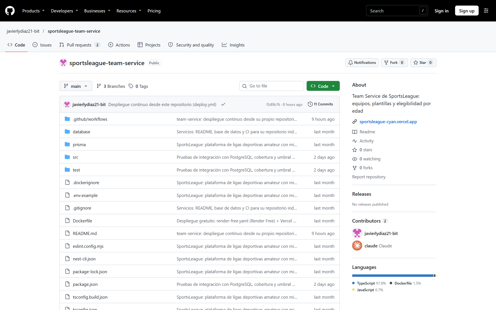

Dirección: https://github.com/javierlydiaz21-bit/sportsleague-team-service · Tomada el 18/11/2026 a
las 17:01.

**Captura 2.** Carpeta `database/` con el esquema, los datos de ejemplo y el respaldo.

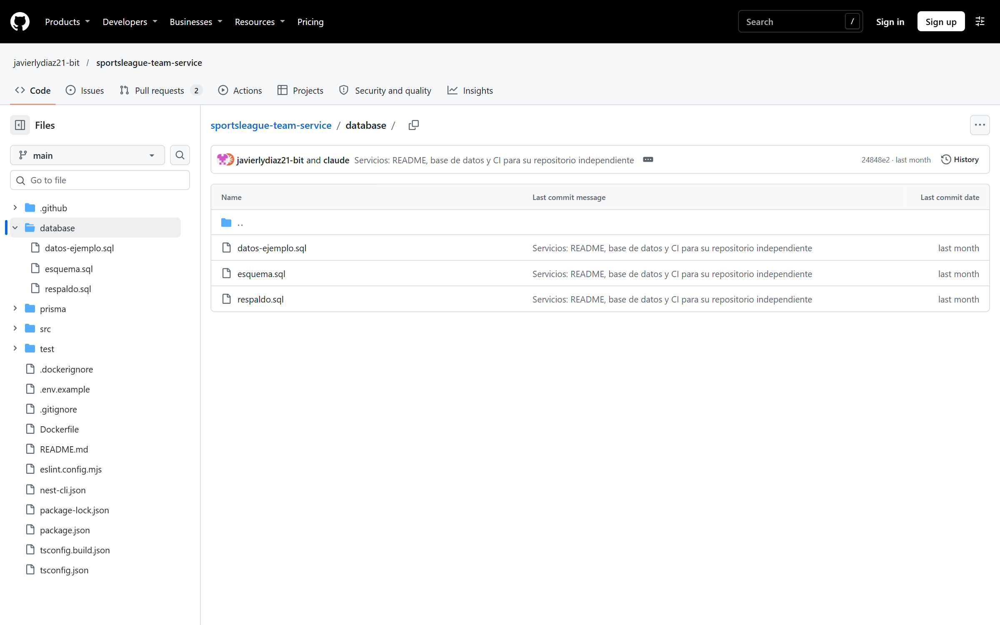

Dirección: https://github.com/javierlydiaz21-bit/sportsleague-team-service/tree/main/database ·
Tomada el 18/11/2026 a las 17:01.

**Captura 3.** Historial de commits del repositorio principal (rama `main`).

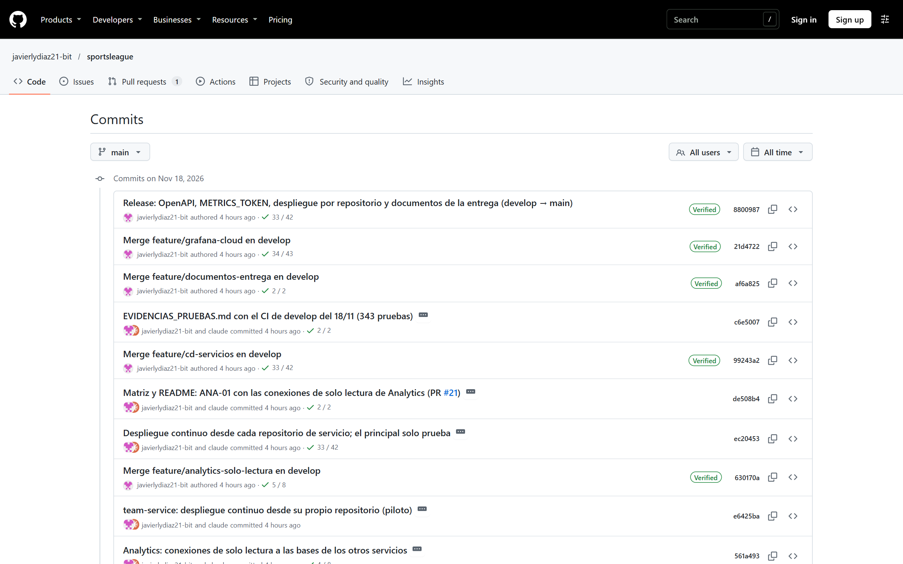

Dirección: https://github.com/javierlydiaz21-bit/sportsleague/commits/main · Tomada el 18/11/2026 a
las 17:02.

### A.3 Enlaces de despliegue

**Qué pide la guía:** un enlace activo por microservicio, conectado a su base de datos, con las
credenciales en variables de entorno; las integraciones externas funcionando en producción; y el
enlace a la documentación de la API, al frontend y al gateway, con usuarios y datos de prueba.

**Plataformas (planes gratuitos):**

- **Render Free:** los 10 microservicios como servicios web, una PostgreSQL con una base por servicio
  (`DATABASE_NAME` elige la base de la misma instancia) y Redis. Cada servicio ejecuta la imagen
  `ghcr.io/javierlydiaz21-bit/sportsleague-app-<servicio>`.
- **Vercel Hobby:** la web.

| Servicio | Enlace | Estado | Documentación de la API |
|---|---|---|---|
| API Gateway | https://sportsleague-jd-gateway.onrender.com | [/health](https://sportsleague-jd-gateway.onrender.com/health) | [Endpoints principales](https://github.com/javierlydiaz21-bit/sportsleague-api-gateway#endpoints-principales) |
| Auth | https://sportsleague-jd-auth.onrender.com | [/health](https://sportsleague-jd-auth.onrender.com/health) | [Endpoints principales](https://github.com/javierlydiaz21-bit/sportsleague-auth-service#endpoints-principales) |
| League | https://sportsleague-jd-league.onrender.com | [/health](https://sportsleague-jd-league.onrender.com/health) | [Endpoints principales](https://github.com/javierlydiaz21-bit/sportsleague-league-service#endpoints-principales) |
| Team | https://sportsleague-jd-team.onrender.com | [/health](https://sportsleague-jd-team.onrender.com/health) | [Endpoints principales](https://github.com/javierlydiaz21-bit/sportsleague-team-service#endpoints-principales) |
| Fixture | https://sportsleague-jd-fixture.onrender.com | [/health](https://sportsleague-jd-fixture.onrender.com/health) | [Endpoints principales](https://github.com/javierlydiaz21-bit/sportsleague-fixture-service#endpoints-principales) |
| Referee | https://sportsleague-jd-referee.onrender.com | [/health](https://sportsleague-jd-referee.onrender.com/health) | [Endpoints principales](https://github.com/javierlydiaz21-bit/sportsleague-referee-service#endpoints-principales) |
| Live Score | https://sportsleague-jd-live.onrender.com | [/health](https://sportsleague-jd-live.onrender.com/health) | [Endpoints principales](https://github.com/javierlydiaz21-bit/sportsleague-live-score-service#endpoints-principales) |
| Statistics | https://sportsleague-jd-statistics.onrender.com | [/health](https://sportsleague-jd-statistics.onrender.com/health) | [Endpoints principales](https://github.com/javierlydiaz21-bit/sportsleague-statistics-service#endpoints-principales) |
| Notification | https://sportsleague-jd-notification.onrender.com | [/health](https://sportsleague-jd-notification.onrender.com/health) | [Endpoints principales](https://github.com/javierlydiaz21-bit/sportsleague-notification-service#endpoints-principales) |
| Analytics | https://sportsleague-jd-analytics.onrender.com | [/health](https://sportsleague-jd-analytics.onrender.com/health) | [Endpoints principales](https://github.com/javierlydiaz21-bit/sportsleague-analytics-service#endpoints-principales) |

**Conexión con la base de datos.** `GET /health` responde `200` solo si el servicio llega a su base y
a Redis, y `503` si no. Las credenciales no están en el código: `DATABASE_URL` y `REDIS_URL` están en
las variables de cada servicio en Render, y `JWT_SECRET` e `INTERNAL_API_TOKEN`, en el grupo de
variables compartido `sportsleague-free-shared`. La base gratuita de Render vence el 16/12/2026.

**Integraciones externas en producción** (variables en Render → `sportsleague-jd-notification`):

| Integración | Cómo funciona | Variables |
|---|---|---|
| Correo real | Notification envía por HTTPS a un Google Apps Script que manda el correo desde Gmail (Render Free bloquea los puertos SMTP) | `MAIL_RELAY_URL`, `MAIL_RELAY_SECRET` |
| Push en el navegador | Web Push con claves VAPID y el service worker de la web | `VAPID_PUBLIC_KEY`, `VAPID_PRIVATE_KEY`, `VAPID_SUBJECT` |

**Usuarios de prueba** (detalle en [ENLACES_Y_USUARIOS.md](../ENLACES_Y_USUARIOS.md)). Los datos de
prueba son la liga «Liga Amateur de Montería», ya cargada en producción:

| Rol | Correo | Contraseña |
|---|---|---|
| Administrador | `admin@sportsleague.com` | Se entrega por privado |
| Organizador | `organizador@demo.com` | `Demo12345` |
| Organizadora (2 ligas pendientes de aprobación) | `organizadora@demo.com` | `Demo12345` |
| Árbitro | `arbitro@demo.com` | `Demo12345` |
| Aficionado | `aficionado@demo.com` | `Demo12345` |

Los servicios gratuitos se duermen tras 15 minutos sin tráfico. Antes de una revisión,
`scripts/despertar.ps1` los despierta y espera a que los 10 y la web respondan `200` (README, sección
«Antes de una demostración»).

**Captura 4.** Variables de entorno de `sportsleague-jd-team` en Render: las credenciales están en la
plataforma y sus valores se ven ocultos.

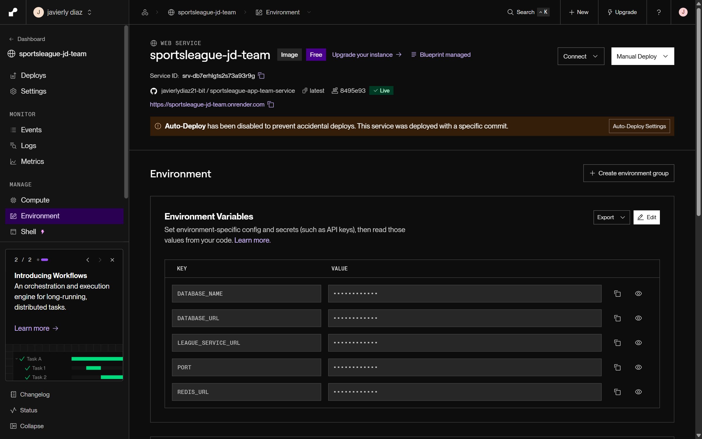

Dirección: https://dashboard.render.com/web/srv-db7erhlg1s2s73a93r9g/env · Tomada el 18/11/2026 a las
17:19.

**Captura 5.** Web en producción: «Liga Amateur de Montería», pestaña *Posiciones*, con la sesión del
aficionado de prueba.

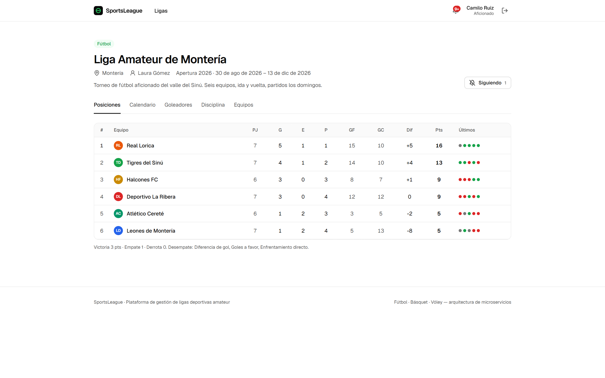

Dirección: https://sportsleague-cyan.vercel.app/ligas/0168ab73-ff3f-4a6d-8448-00402efffc3c?tab=posiciones ·
Tomada el 18/11/2026 a las 17:04.

### A.4 Pruebas automatizadas

**Qué pide la guía:** por microservicio, dos pruebas unitarias con mocks y una de integración, en su
repositorio; un comando documentado en el README; la evidencia de su ejecución en local y en GitHub
Actions; y el reporte de cobertura generado en el pipeline y disponible como artefacto.

**Evidencia:** [EVIDENCIAS_PRUEBAS.md](../EVIDENCIAS_PRUEBAS.md), con el archivo de cada prueba, lo que
simula con Jest y los resultados del CI del 18/11/2026 sobre `develop` (commit `99243a2`).

| Microservicio | Prueba unitaria 1 | Prueba unitaria 2 | Prueba de integración | Cobertura de líneas (con chassis / sin chassis) |
|---|---|---|---|---|
| api-gateway | «consulta el /health de todos los servicios como mucho una vez por intervalo» | «no retrasa ni rompe la petición si un servicio no responde» | `gateway.integration.spec.ts`: la cadena completa del gateway frente a los 9 servicios simulados por HTTP (enrutamiento, JWT, roles, CORS, rate limiting con 429, 503 y `/metrics`) | 57,46 % / 88,63 % |
| auth-service | «suspender a un usuario revoca sus sesiones, lo marca en Redis para el gateway y publica user.updated» | «el administrador no puede cambiar su propio rol o estado» | `auth.integration.spec.ts`: registro, inicio de sesión, rotación del refresh token con CSRF, detección de reutilización y suspensión por el administrador, sobre PostgreSQL | 64,39 % / 84,10 % |
| league-service | «crea la liga pendiente de aprobación y avisa con league.created» | «el administrador aprueba la liga y se publica league.reviewed» | `league.integration.spec.ts`: crea una liga y su temporada en PostgreSQL y las lee por HTTP; 401 sin token interno, 400 con fechas inválidas y 403 a otro organizador | 59,22 % / 69,46 % |
| team-service | «valida la elegibilidad automáticamente al fichar un jugador» | «deja al jugador pendiente cuando no se puede consultar la categoría» | `team.integration.spec.ts`: registra un equipo con los datos de League Service, ficha jugadores y calcula su elegibilidad; 404, 409 y 400; con League Service caído usa la caché | 68,14 % / 70,59 % |
| fixture-service | «genera el calendario completo de la categoría en borrador» | «actualiza el estado del partido de forma idempotente al recibir match.completed» | `fixture.integration.spec.ts`: genera el calendario en borrador, lo publica (un `fixture.published` por jornada), reprograma un partido y sigue `match.started` y `match.completed` | 72,07 % / 84,42 % |
| referee-service | «asigna automáticamente al árbitro de la misma zona y publica referee.assigned» | «avisa con referee.unassigned cuando nadie está disponible» | `referee.integration.spec.ts`: registra árbitros, los asigna por zona al recibir `fixture.published` sin duplicar, avisa si nadie está disponible y busca reemplazo cuando el árbitro rechaza | 60,04 % / 68,86 % |
| live-score-service | «el árbitro asignado registra un gol, se calcula el marcador y se publica match.event» | «al finalizar publica el acta (match.completed) con el marcador y la versión» | `live.integration.spec.ts`: el árbitro inicia el partido y registra un gol que un espectador recibe por WebSocket; acta con `match.completed` y corrección versionada | 74,43 % / 93,84 % |
| statistics-service | «recalcula la tabla al recibir match.completed y avisa con standings.updated» | «procesar el mismo evento dos veces no duplica efectos (idempotencia)» | `statistics.integration.spec.ts`: con `match.completed` recalcula tabla, goleadores y tarjetas; acta repetida, corrección y conciliación con Live Score Service | 74,64 % / 93,42 % |
| notification-service | «notifica al organizador y a los aficionados de la liga, y registra los envíos» | «respeta las preferencias: sin correo ni push para quien los desactivó» | `notification.integration.spec.ts`: suscripciones y preferencias; `league.created` y `match.completed` generan avisos y correos por el relé simulado; idempotencia y relé caído (FAILED) | 70,43 % / 85,53 % |
| analytics-service | «extrae de las réplicas, carga las tablas en una sola transacción y marca la corrida SUCCESS» | «si una réplica no responde registra la corrida FAILED y no toca las tablas analíticas» | `analytics.integration.spec.ts`: ETL sobre réplicas de solo lectura en PostgreSQL (KPIs, asistencia y tendencia); una segunda corrida no duplica filas y una réplica caída deja la corrida FAILED | 60,32 % / 91,26 % |

- **Total:** 343 pruebas (342 pasan y 1 opcional, la de correo real, se omite sin credenciales).
- **Mocks:** las unitarias usan dobles de Jest (`jest.fn()`, `jest.mock()`) para Prisma, Redis, el
  bus de eventos y los clientes de otros servicios. Las de integración usan PostgreSQL real y simulan
  con servidores HTTP locales los microservicios de los que depende cada uno.
- **Cobertura:** Jest/Istanbul. *Con chassis* mide todo `src/` salvo `main.ts`, incluido el código
  común que se copia en los 10 servicios; *sin chassis*, solo el código propio del servicio. El CI
  falla si la cobertura de líneas baja del 50 % (`coverageThreshold`).
- **Artefacto:** cada ejecución del CI guarda el informe como `coverage-<servicio>`.

Comandos, desde `services/<servicio>` (documentados en el README de cada servicio):

```bash
npm ci
npx prisma generate        # todos menos api-gateway, que no tiene base de datos
npm run test:unit          # unitarias
npm run test:integration   # integración (PostgreSQL de Docker Compose: docker compose up -d postgres)
npm run test:cov           # todas, con el informe de cobertura y el umbral del 50 %
```

**Captura 6.** Pruebas de team-service en local (`npm run test:cov`) contra la PostgreSQL de Docker
Compose: resumen de Jest y tabla de cobertura.

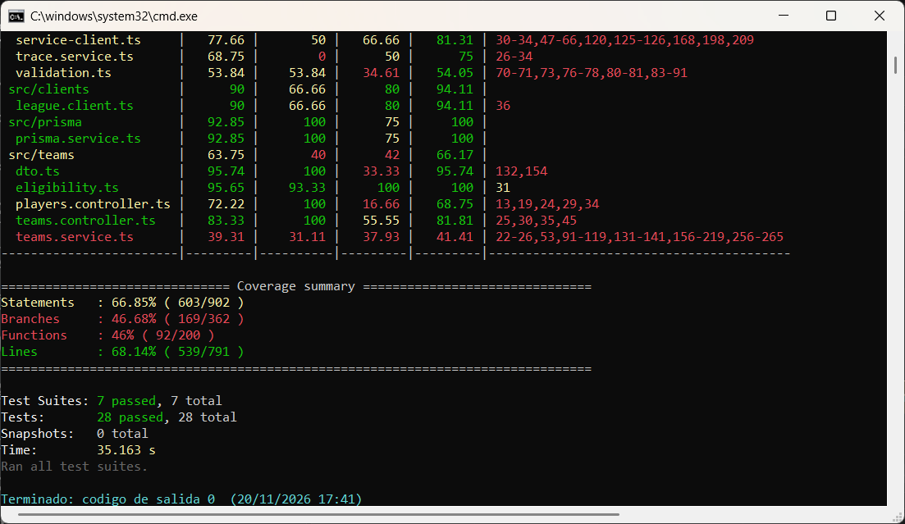

Dirección: terminal de PowerShell en el equipo de desarrollo, con una copia de `services/team-service`
· Tomada el 20/11/2026 a las 17:41.

**Captura 7.** Ejecución del CI de team-service en GitHub Actions, en verde, con el artefacto
`coverage-team-service`.

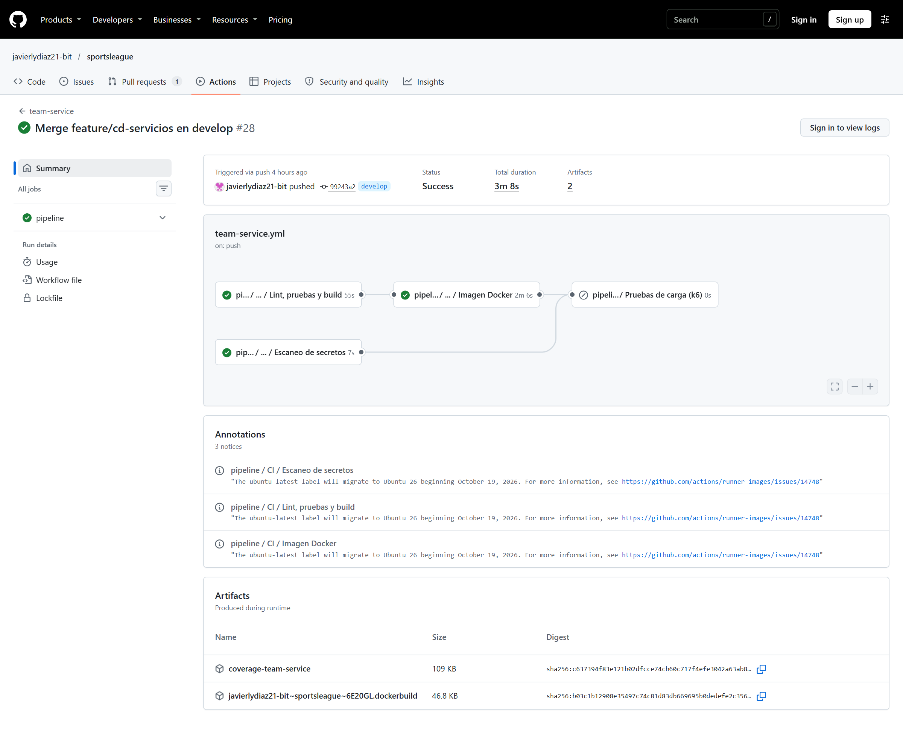

Dirección: https://github.com/javierlydiaz21-bit/sportsleague/actions/runs/44358095467 · Tomada el
18/11/2026 a las 17:02.

**Captura 8.** Informe de cobertura (Istanbul) del artefacto `coverage-team-service`: 68,14 % de
líneas.

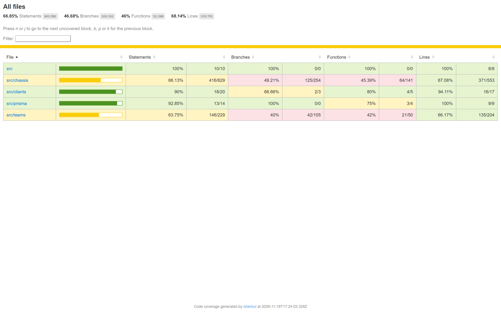

Dirección: archivo `lcov-report/index.html` del artefacto `coverage-team-service` de la ejecución
https://github.com/javierlydiaz21-bit/sportsleague/actions/runs/44358095467, abierto en el navegador
después de descargarlo · Tomada el 18/11/2026 a las 17:03.

### A.5 Despliegue automatizado con GitHub Actions (CI/CD)

**Qué pide la guía:** el despliegue automatizado con GitHub Actions: un workflow de CI en cada push y
pull request que instale dependencias, ejecute las pruebas y genere la cobertura, y falle si una prueba
falla; un workflow de CD que despliegue al integrar en la rama principal y dependa de las pruebas; los
secretos en GitHub Secrets; y como evidencia, ejecuciones exitosas, un cambio que termina en un
despliegue automático, la reacción ante una prueba fallida y la estrategia de ramas.

**Workflows de cada repositorio de servicio:**

| Archivo | Se activa con (`on`) | Qué hace |
|---|---|---|
| `.github/workflows/ci.yml` | Pull requests hacia `main` o `develop`, push a `develop` y ejecución manual | Llama al CI compartido `ci-servicio.yml@v1`: *Lint, pruebas y build* (npm ci → Prisma → ESLint → Jest con PostgreSQL 16 y cobertura → informe como artefacto → build), *Escaneo de secretos* (gitleaks) e *Imagen Docker* (construye sin publicar) |
| `.github/workflows/deploy.yml` («Despliegue continuo») | Push a `main`, es decir, al fusionar un pull request, y ejecución manual | 1) Corre el mismo CI. 2) Solo si pasa, publica la imagen `:<sha>` y `:latest` en GitHub Container Registry. 3) Llama al *deploy hook* de Render con la imagen de ese commit. Si falta el secreto del hook, el despliegue falla |

**Estado:** `ci.yml` está en los 10 repositorios de servicio. `deploy.yml` está en `main` de
`sportsleague-team-service`, donde ya desplegó automáticamente (evidencia abajo). Para los otros 9 está
listo en el repositorio principal (`services/<servicio>/.github/workflows/deploy.yml`), con su secreto
`RENDER_DEPLOY_HOOK` ya configurado en cada repositorio; llega a su `main` con el siguiente release.

En el repositorio principal, cada servicio tiene además su workflow (`<servicio>.yml`, que llama a
`service-pipeline.yml`). Se activa con push a `main` o `develop` y con pull requests cuando cambia ese
servicio. Corre el mismo CI y, en Live Score, pruebas de carga con k6, pero no publica imágenes ni
despliega, para que nada se despliegue dos veces. Los workflows usan Node.js 22 y fijan cada acción por
su SHA con la versión en un comentario. Los pasos propios del CI tienen nombres descriptivos en español,
por ejemplo «Instalar dependencias (npm ci)» y «Pruebas unitarias e integración (Jest)».

**Un cambio que termina en un despliegue automático.** En `sportsleague-team-service`, el push a `main`
del commit `f3d9b76` disparó «Despliegue continuo», que pasó el CI, publicó la imagen y desplegó
`sportsleague-app-team-service:f3d9b764d7c89012205a332e196ce06c85cdb8cb` en Render.

**Captura 9.** «Despliegue continuo» en verde: los jobs del CI y, después, *Despliegue en Render*.

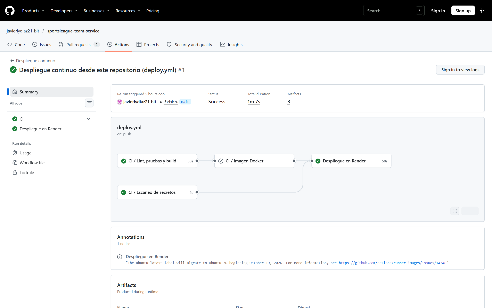

Dirección: https://github.com/javierlydiaz21-bit/sportsleague-team-service/actions/runs/44313143371 ·
Tomada el 18/11/2026 a las 17:02.

**Reacción ante una prueba fallida.** En `main` de cada repositorio de servicio, GitHub exige pull
request y los checks *ci / Lint, pruebas y build*, *ci / Escaneo de secretos* y *ci / Imagen Docker* en
verde, también para los administradores, y no permite *force push*. Evidencia: el pull request
[«DEMO: prueba fallida — no fusionar»](https://github.com/javierlydiaz21-bit/sportsleague-team-service/pull/5)
(rama `demo/falla-prueba`):

- La prueba «elegibilidad de jugadores › calcula la edad cumplida considerando el día del cumpleaños»
  falla (esperado 19, recibido 18). *ci / Lint, pruebas y build* falla y *ci / Imagen Docker* se omite.
- GitHub bloquea el merge. Sin merge a `main`, `deploy.yml` no corre: no se publica imagen ni se
  despliega.

**Captura 10.** Pull request #5 bloqueado: el check requerido *Lint, pruebas y build* falla, *Imagen
Docker* se omite y el botón de merge queda deshabilitado.

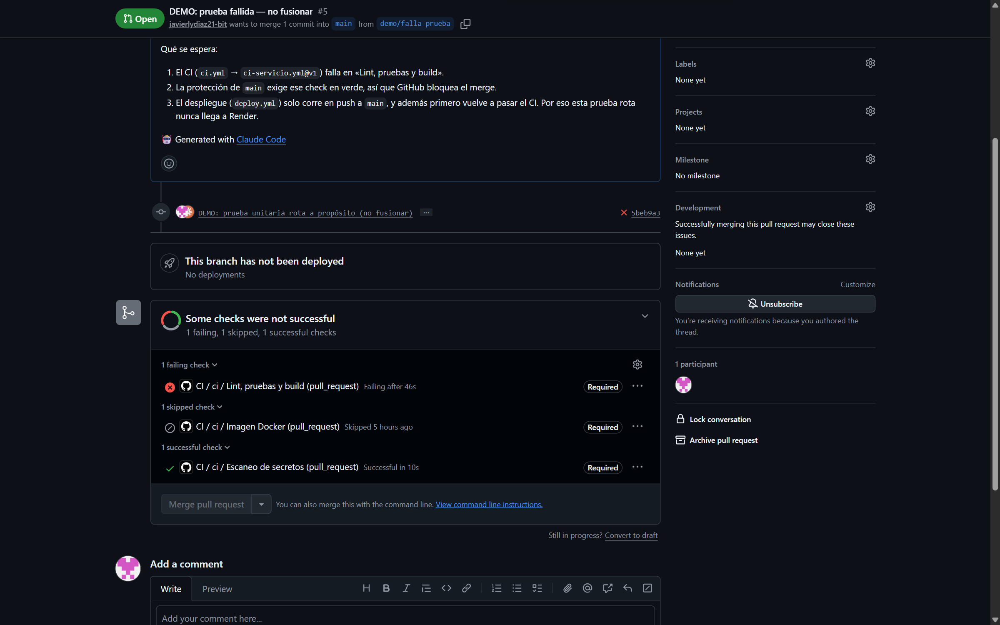

Dirección: https://github.com/javierlydiaz21-bit/sportsleague-team-service/pull/5 · Tomada el
18/11/2026 a las 17:19.

**Captura 11.** El job del pull request #5: falla el paso de Jest y no corren *Compilar* ni *Imagen
Docker*.

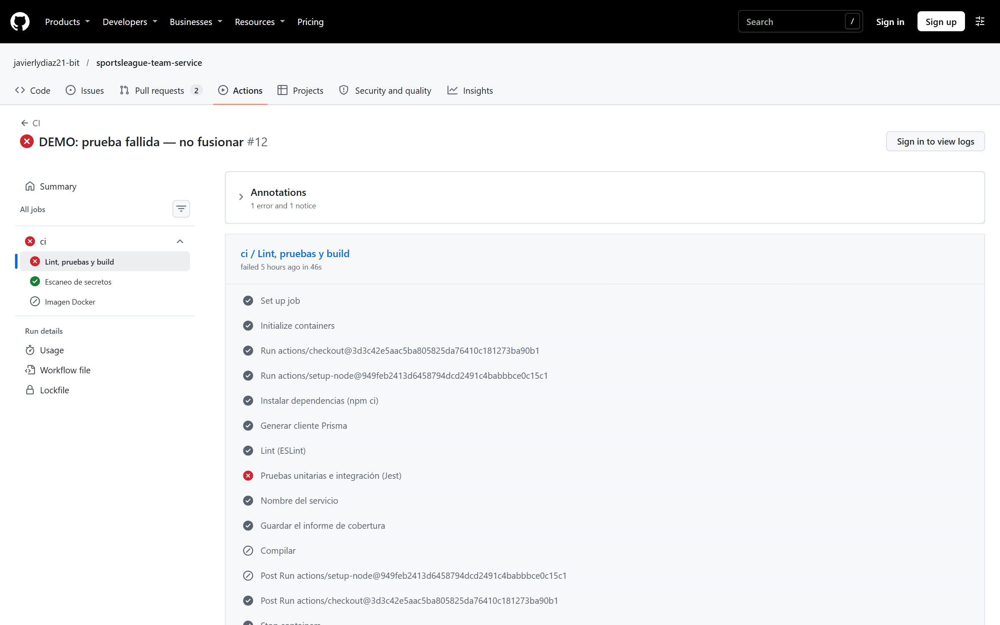

Dirección: https://github.com/javierlydiaz21-bit/sportsleague-team-service/actions/runs/44354414262/job/134978507531 ·
Tomada el 18/11/2026 a las 17:02.

**Secretos.** Cada repositorio de servicio tiene un solo secreto en GitHub Secrets,
`RENDER_DEPLOY_HOOK`, que solo lee el job de despliegue; el YAML lo referencia como
`${{ secrets.RENDER_DEPLOY_HOOK }}`. El `GITHUB_TOKEN` solo tiene permiso para publicar paquetes en ese
job. Las credenciales de la base de datos y los demás secretos de ejecución están en las variables de
Render (captura 4), no en GitHub ni en el código.

**Captura 12.** Secretos de Actions de `sportsleague-team-service`: solo `RENDER_DEPLOY_HOOK`, sin su
valor.

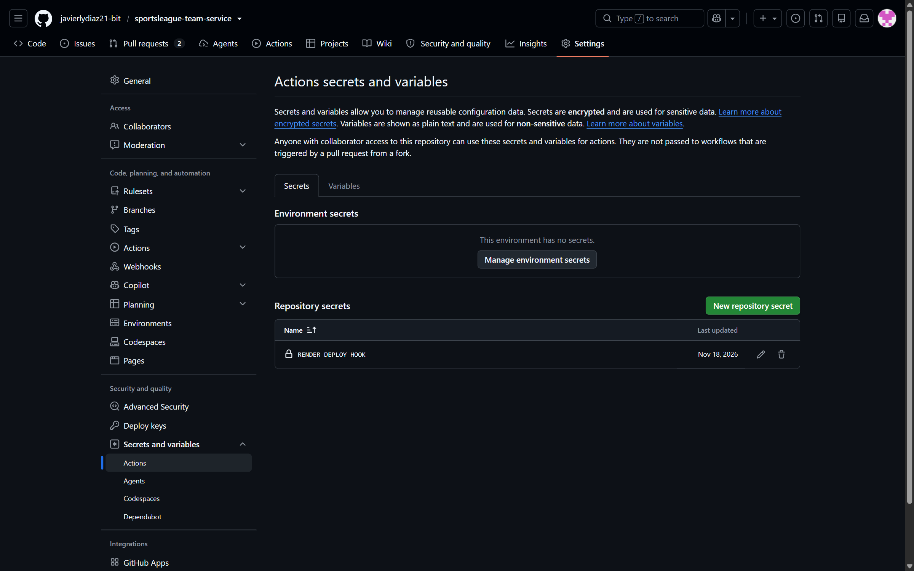

Dirección: https://github.com/javierlydiaz21-bit/sportsleague-team-service/settings/secrets/actions ·
Tomada el 18/11/2026 a las 17:20.

**Captura 13.** Regla de protección de `main`: los tres checks del CI son obligatorios y no se puede
saltar la regla.

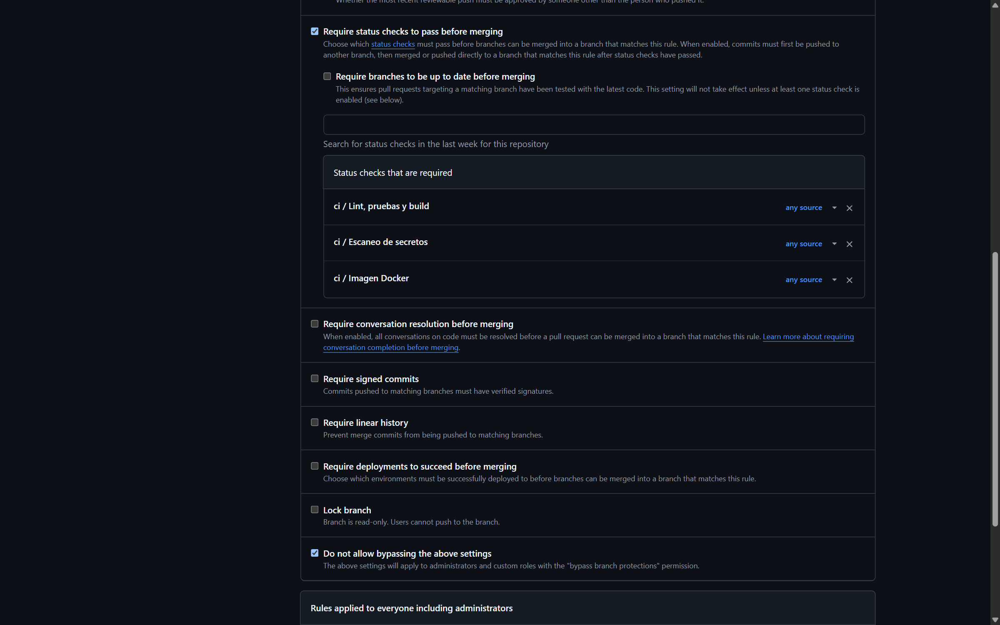

Dirección: https://github.com/javierlydiaz21-bit/sportsleague-team-service/settings/branch_protection_rules/84983266 ·
Tomada el 18/11/2026 a las 17:20.

**Estrategia de ramas y control de versiones** (README, «Estrategia de ramas y control de versiones»):

| Rama | Para qué | Cómo cambia |
|---|---|---|
| `main` | Lo que está en producción | Solo por pull request, también para los administradores, y sin *force push*. En los repositorios de servicio exige además los checks del CI en verde, y cada merge despliega ese servicio |
| `develop` | Integración de lo terminado | Pull requests desde `feature/*` con el CI en verde |
| `feature/*` | Un cambio cada una (p. ej. `feature/openapi`, `feature/metrics-token`) | Se crean desde `develop` y vuelven a `develop` por pull request |
| `hotfix/*` | Urgencias de producción | Se crean desde `main` y se fusionan en `main` y en `develop` |
| `demo/*` | Demostraciones que nunca se fusionan (p. ej. `demo/falla-prueba`) | — |

Release: pull request de `develop` a `main` en el repositorio principal; después, para cada servicio que
cambió, `git subtree split` hacia `develop` de su repositorio y pull request de `develop` a `main`, que
lo despliega. Versionado: el CI compartido usa las etiquetas `v1.0.0`, `v1.1.0` y `v1`; las imágenes
llevan el `sha` del commit; la API, el prefijo `/api/v1`. Para volver atrás se despliega en Render la
imagen de un `sha` anterior.

### A.6 Monitoreo con Prometheus y Grafana

**Qué pide la guía:** `/metrics` en cada microservicio y Prometheus configurado para recolectarlas
(`prometheus.yml` con los targets); al menos un dashboard de Grafana conectado a Prometheus con
disponibilidad, número de peticiones, tiempos de respuesta y tasa de errores; y capturas del dashboard
con datos reales y de los targets en UP, con los archivos de configuración en el repositorio.

- **`/metrics`:** los 10 servicios exponen métricas HTTP con `prom-client` y métricas del negocio, por
  ejemplo `match_events_registered_total`, `live_score_update_latency_seconds`, `live_viewers_total`,
  `standings_recalculations_total`, `referee_assignments_total`, `circuit_breaker_state` y
  `gateway_rate_limit_rejections_total`.
- **Prometheus:** [`infra/prometheus/prometheus.yml`](../infra/prometheus/prometheus.yml) recoge los 10
  servicios cada 15 s. Las alertas están en [`infra/prometheus/alerts.yml`](../infra/prometheus/alerts.yml).
- **Grafana:** dashboard «SportsLeague — Jornada en vivo»
  ([`infra/grafana/dashboards/sportsleague.json`](../infra/grafana/dashboards/sportsleague.json)),
  conectado a Prometheus por el datasource de `infra/grafana/provisioning/`. Por microservicio muestra
  disponibilidad (ARRIBA/CAÍDO), peticiones por segundo, tiempo de respuesta p95 y tasa de errores 5xx,
  más métricas del negocio, con filtros por liga, temporada y categoría.
- **Ejecución:** Prometheus (http://localhost:9090) y Grafana (http://localhost:3100) corren con Docker
  Compose. Las capturas 14 y 15 son de ese entorno, después de unos minutos de uso real de la web local:
  inicios de sesión, consulta de ligas, un aficionado siguiendo un partido y un gol registrado desde
  *Control en vivo*.
- **Producción:** el dashboard está importado en Grafana Cloud ([`infra/grafana-cloud/`](../infra/grafana-cloud/))
  y publicado con un
  [enlace público](https://jademantel3442.grafana.net/public-dashboards/104a3d4644dd4bfaac49d671212d5e66),
  pero todavía no muestra datos: la recolección desde Render no está activa. Leer `/metrics` despierta a
  cada servicio, y Render Free da 750 horas al mes para todo el espacio de trabajo.

**Captura 14.** Prometheus: `sportsleague (10/10 up)`, los 10 microservicios en estado UP.

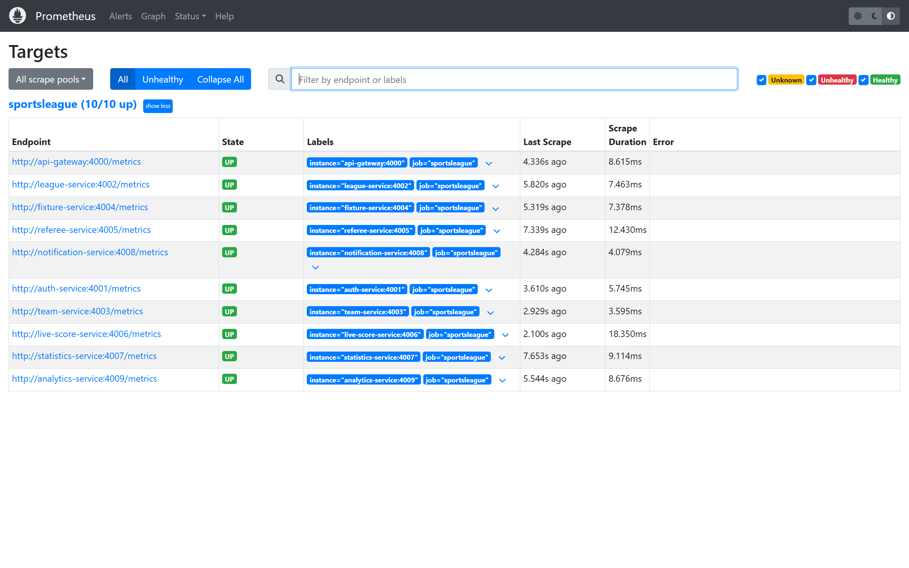

Dirección: http://localhost:9090/targets · Tomada el 18/11/2026 a las 17:27.

**Captura 15.** Grafana, dashboard «SportsLeague — Jornada en vivo» con datos reales de los últimos 15
minutos: 10 microservicios ARRIBA, peticiones por segundo, tiempo de respuesta p95, errores 5xx, el gol
registrado y la latencia del marcador en vivo.

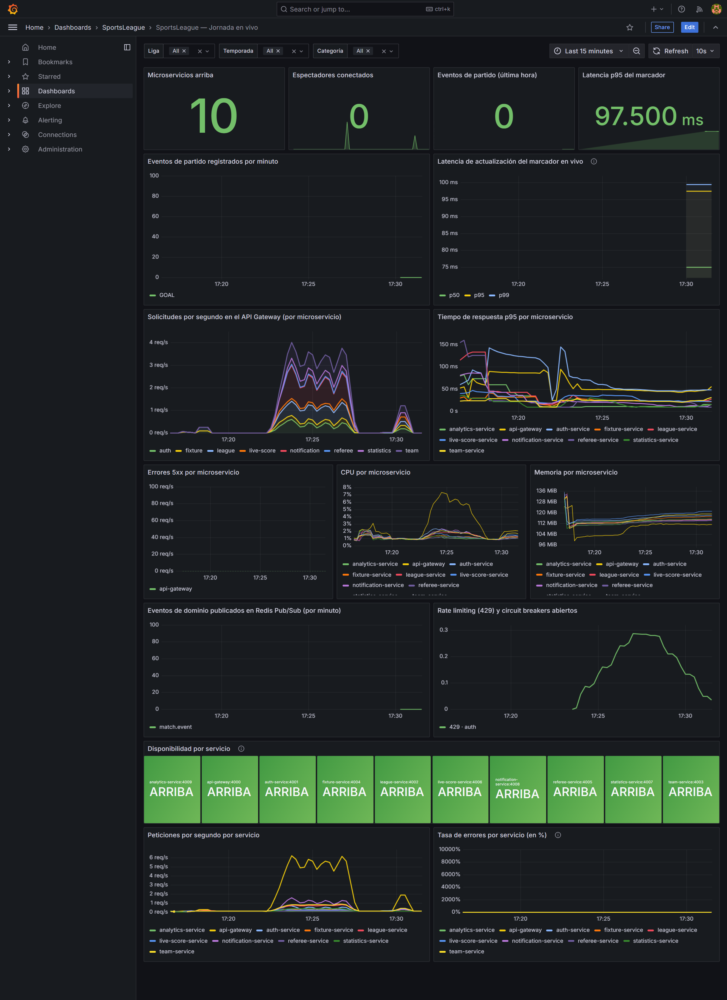

Dirección: http://localhost:3100/d/sportsleague/sportsleague-e28094-jornada-en-vivo?orgId=1&from=now-15m&to=now ·
Tomada el 18/11/2026 a las 17:31.

**Captura 16.** *Administración → Sistema* en producción: los 10 servicios activos, con su base y
Redis, y el enlace al dashboard de Grafana Cloud (arriba a la derecha).

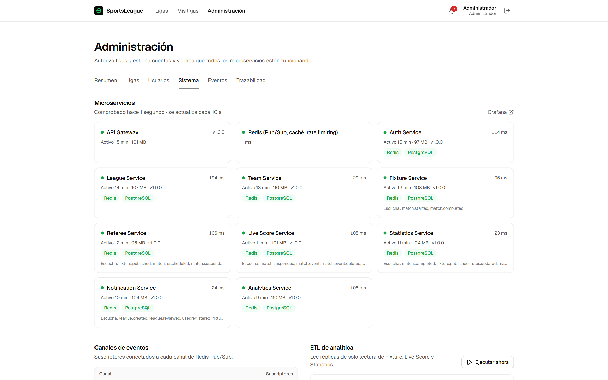

Dirección: https://sportsleague-cyan.vercel.app/admin?tab=sistema · Tomada el 18/11/2026 a las 17:05.

---

## Parte B · Sustentación final

Los cinco momentos de la guía. Las citas son de los documentos de arquitectura del equipo:
«SPORTSLEAGUE — Diseño Arquitectónico y Estrategia DevOps del Sistema» (Momento 1, «M1») y
«SportsLeague — Arquitectura plataforma tecnológicas, Momento 2» («M2»).

### 1. Contexto del problema y necesidades de solución

- **Contexto general (M1, «Visión General del Proyecto», p. 5):** «SportsLeague es una plataforma para
  federaciones y organizadores de ligas amateur (fútbol, básquet, vóley) que manejan varias categorías,
  equipos y sedes al mismo tiempo.»
- **Usuarios:**
  - *Organizadores:* crean su liga, temporadas, categorías y reglamento, canchas, equipos y jugadores, y
    árbitros; generan el calendario y controlan los partidos en vivo.
  - *Administrador:* autoriza, rechaza o suspende las ligas, gestiona las cuentas y verifica que todo
    funcione.
  - *Árbitros:* ven y confirman sus partidos asignados y registran goles, tarjetas y cambios.
  - *Aficionados:* siguen ligas, ven el marcador en tiempo real y reciben avisos.
- **Necesidades detectadas:** dejar las hojas de cálculo y los grupos de WhatsApp; programar los
  partidos de varias categorías y sedes; registrar los resultados en vivo; y mantener informados a
  equipos, jugadores y árbitros. M1 señala dos componentes críticos: el calendario, que debe respetar
  la disponibilidad de canchas y árbitros y el descanso mínimo entre partidos, y el marcador en vivo
  «para miles de espectadores conectados a la vez».
- **Objetivo principal del sistema (M1, «Visión General del Proyecto», p. 5):** reemplazar «las hojas
  de cálculo y los grupos de WhatsApp por un sistema centralizado que programa partidos, registra
  resultados en vivo y mantiene informados a equipos, jugadores y árbitros».
- **Justificación de la solución (M1, 1.1, p. 5):** «se eligió una arquitectura de microservicios en
  lugar de un monolito porque el sistema agrupa dominios de negocio muy distintos entre sí (…) cada uno
  con patrones de carga, criticidad y ritmo de cambio diferentes. (…) Mantener estos dominios en
  servicios independientes permite escalar, desplegar y evolucionar cada uno según su propio perfil de
  uso…».
- **Alcance:**
  - *Restricciones del proyecto (M1, p. 5):* «microservicios, base de datos relacional independiente
    por servicio, CI/CD con GitHub Actions, despliegue sin AWS/Azure/GCP, y Docker obligatorio».
  - *Lo que se construyó:* 10 microservicios (los 8 del documento más Auth y el API Gateway), la web,
    la app móvil para árbitros y espectadores, el despliegue en Render y Vercel, las pruebas, el CI/CD y
    el monitoreo.

### 2. Aspectos técnicos de la arquitectura

**Arquitectura basada en microservicios.** Cada dominio es un servicio NestJS independiente, con su
propia base de datos, su Dockerfile, su repositorio y su pipeline. Todo el tráfico de los clientes
entra por el API Gateway; el marcador en vivo llega por WebSocket desde Live Score.

**Función de cada microservicio** (README, «Microservicios»):

| Servicio | Responsabilidad | Llama por REST a | Publica | Consume |
|---|---|---|---|---|
| API Gateway | Enrutamiento, validación de JWT, bloqueo de cuentas suspendidas, rate limiting, CORS, logs, salud agregada | todos | — | — |
| Auth | Cuentas, roles, contraseñas (bcrypt), access + refresh tokens rotativos | — | `user.registered`, `user.updated` | — |
| League | Ligas (aprobación del admin), temporadas, categorías, reglamento, canchas | — | `league.created`, `league.reviewed`, `rules.updated` | — |
| Team | Equipos, plantillas, elegibilidad automática por edad | League | — | — |
| Fixture | Generación del calendario, partidos manuales, reprogramaciones, suspensiones | League, Team | `fixture.published` (por jornada), `match.rescheduled`, `match.suspended` | `match.started`, `match.completed` |
| Referee | Árbitros, disponibilidad, asignación automática | — | `referee.assigned`, `referee.unassigned` | `fixture.published`, `match.rescheduled`, `match.suspended`, `match.completed` |
| Live Score | Eventos en vivo (REST) y difusión por WebSocket, actas versionadas | Fixture, Referee, Team | `match.started`, `match.event`, `match.event.deleted`, `match.completed` | `match.suspended` |
| Statistics | Tabla de posiciones, goleadores, disciplina (recálculo idempotente, caché Redis) | League, Live Score | `standings.updated` | `match.completed`, `fixture.published`, `rules.updated`, `match.event` |
| Notification | Bandeja de notificaciones, seguidores de ligas, correo real con Gmail y push en el navegador | Team | — | `league.*`, `user.registered`, `fixture.published`, `referee.*`, `match.rescheduled`, `match.suspended`, `match.completed` |
| Analytics | ETL periódico: asistencia estimada, partidos suspendidos, tendencia de rendimiento, KPIs | — | — | — |

**Comunicación entre servicios:**

- **REST síncrono** solo donde se necesita una respuesta inmediata: Fixture → League y Team al generar
  el calendario, Team → League para el rango de edad, Statistics → League para el reglamento, Live
  Score → Fixture al iniciar el partido y → Referee para validar permisos. Todas las llamadas usan el
  cliente común (`ServiceClient`) con *timeout*, reintentos con *backoff* exponencial (solo lecturas) y
  *circuit breaker*, y llevan un token interno (`x-internal-token`).
- **Eventos asíncronos** en Redis Pub/Sub para el flujo del partido, con consumidores idempotentes.
- **WebSocket** (Socket.IO) para difundir el marcador a los espectadores.

**Uso de APIs.** API REST versionada bajo `/api/v1`, documentada en el README de cada servicio y con
OpenAPI (`/docs` y `/openapi.json`) en el código, y validada con `class-validator` en los DTO.
Integraciones externas: Google Apps Script (correo) y Web Push.

**Patrón SAGA: no está implementado.** Fue una decisión de diseño. M1 (4.3, p. 22): «El patrón Saga
no resulta crítico para este dominio de negocio, a diferencia de un sistema de comercio electrónico
donde una orden dispara una cadena estricta de pasos compensables (pago, inventario, envío). En
SportsLeague no existe una transacción de negocio que requiera revertirse en cadena: si el recálculo de
estadísticas falla tras un match.completed, basta con reintentar el procesamiento del evento de forma
idempotente. Por ello se prioriza la consistencia eventual entre los resultados registrados y las
estadísticas calculadas, apoyada en un mecanismo de recálculo idempotente…».

El código sigue esa decisión: no hay orquestador de saga ni transacciones de compensación. En su lugar,
consistencia eventual con estos mecanismos, cada uno con su prueba:

| Mecanismo | Dónde se demuestra (prueba) |
|---|---|
| Statistics procesa cada acta una sola vez aunque el evento llegue repetido | `statistics-service/src/statistics/statistics.service.spec.ts`: «procesar el mismo evento dos veces no duplica efectos (idempotencia)». Integración: «un acta repetida no duplica efectos, la corrección se aplica y una versión vieja se ignora» |
| Si se perdió un `match.completed`, *Recalcular* recupera el acta de Live Score (conciliación) | `statistics-service/test/integration/statistics.integration.spec.ts`: «el organizador recalcula con conciliación y recupera del Live Score Service el acta que se había perdido» |
| Las correcciones del acta tras el cierre se republican con una versión nueva | `live-score-service/src/live/live.service.spec.ts`: «una corrección posterior al cierre republica el acta con una nueva versión» |
| Referee no asigna dos veces el mismo partido | `referee-service/src/assignments/referees.service.spec.ts`: «no asigna dos veces el mismo partido si el evento se repite (idempotencia)» |
| Notification no duplica avisos ni correos | `notification-service/src/notifications/notifications.service.spec.ts`: «no duplica notificaciones si el mismo evento llega dos veces». Integración: «si el mismo mensaje se entrega dos veces no se duplican avisos ni correos (idempotencia)» |
| Fixture actualiza el estado del partido sin retroceder | `fixture-service/src/fixtures/fixtures.service.spec.ts`: «actualiza el estado del partido de forma idempotente al recibir match.completed» |

**Manejo de bases de datos.** Una base PostgreSQL por servicio (`auth_db`, `league_db`, `team_db`,
`fixture_db`, `referee_db`, `livescore_db`, `statistics_db`, `notification_db`, `analytics_db`), con su
esquema y migraciones de Prisma. Ningún servicio consulta la base de otro: los datos de otro dominio se
piden por REST o llegan por eventos, y los identificadores de otros servicios (por ejemplo,
`category_id` en Team) se guardan sin clave foránea entre bases. En local cada base tiene su propio
usuario de PostgreSQL. En Render Free todas las bases están en una sola instancia, con el mismo usuario.
Redis se usa como bus de eventos, caché y contador del rate limiting.

Diagramas entidad-relación de cada base, generados desde su `prisma/schema.prisma` (las fuentes Mermaid
están en `docs/diagramas/er-*.mmd`):

**Auth (`auth_db`)**

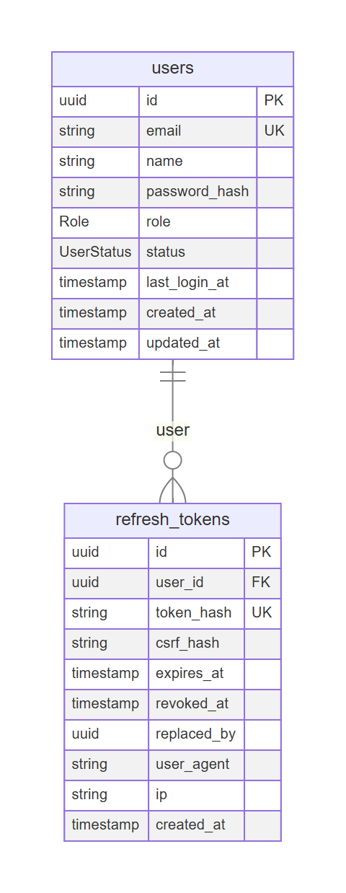

**League (`league_db`)**

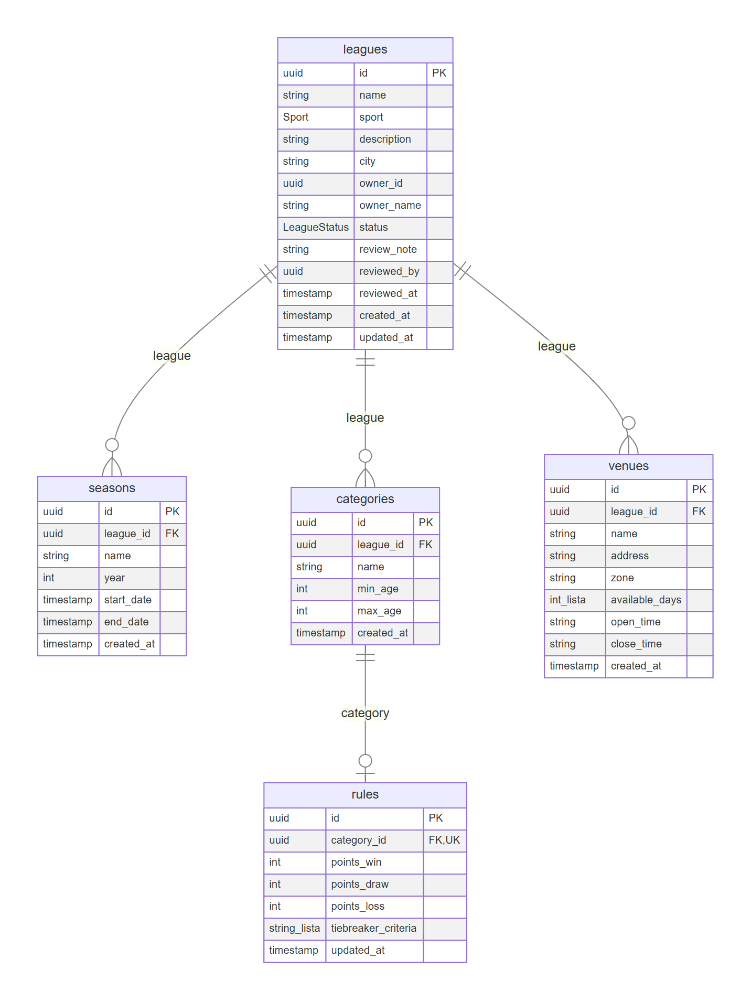

**Team (`team_db`)**

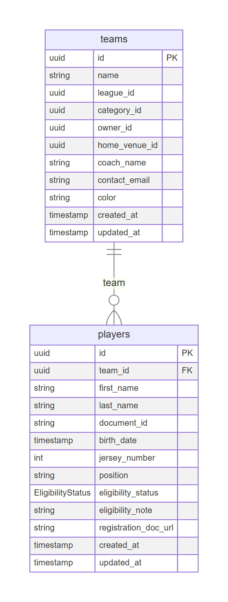

**Fixture (`fixture_db`)**

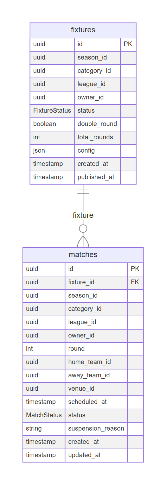

**Referee (`referee_db`)**

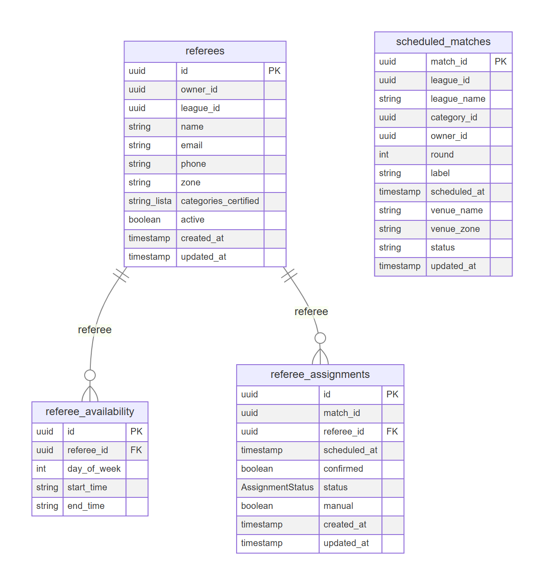

**Live Score (`livescore_db`)**

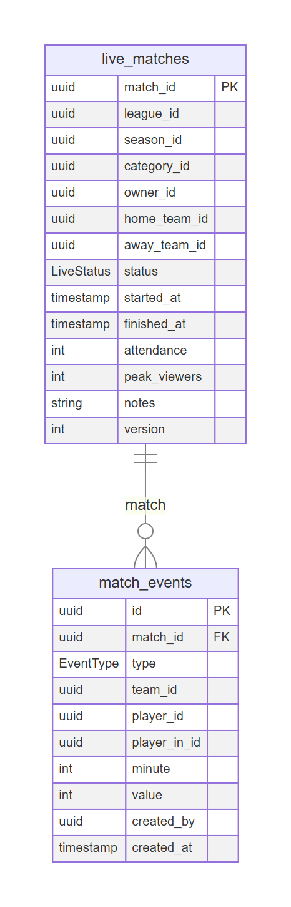

**Statistics (`statistics_db`)**

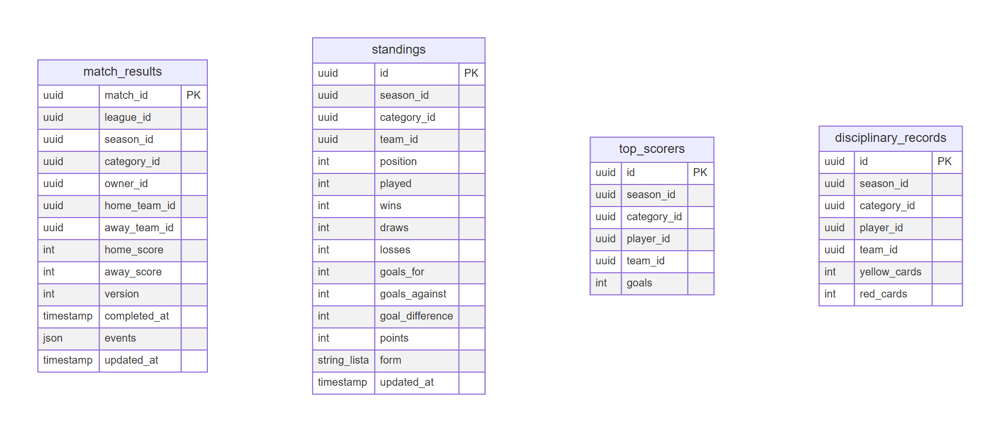

**Notification (`notification_db`)**

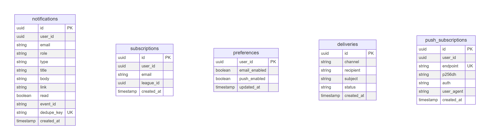

**Analytics (`analytics_db`)**

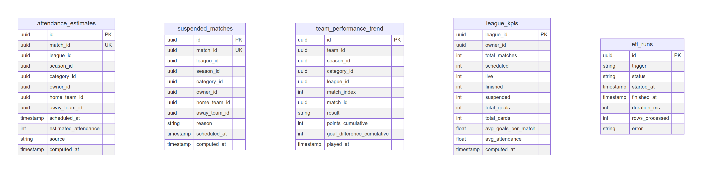

**Orquestación o coordinación de servicios.** No hay un orquestador central: el flujo del partido se
coordina por eventos. M1 (4.2, p. 22) dice: «El flujo operativo central del sistema (…) se coordina en
su totalidad mediante eventos asíncronos publicados sobre Redis Pub/Sub». Cada servicio reacciona a los
eventos que le interesan. Los contenedores se orquestan con Docker Compose en local y con Render en
producción.

**API Gateway.** Único punto de entrada (`/api/v1/*`):

- enruta por prefijo al servicio correcto y valida el JWT, de modo que responde `401` sin llegar a los
  servicios;
- bloquea las cuentas suspendidas, las rutas internas y las de administración a quien no es `ADMIN`;
- aplica rate limiting en Redis por niveles (inicio de sesión, escritura y lectura) y CORS solo para la
  web;
- registra cada petición y agrega la salud de los servicios;
- en Render Free despierta a los servicios dormidos.

**Autenticación y autorización:**

- Auth Service guarda las contraseñas con bcrypt y emite un access token JWT y un refresh token
  rotativo en una cookie `httpOnly` con `SameSite`, protegida además con un token anti-CSRF.
- Si reaparece un refresh token ya usado, cierra todas las sesiones del usuario.
- Roles: `ADMIN`, `ORGANIZER`, `REFEREE` y `SPECTATOR`.
- Cada servicio aplica permisos de dominio: solo el organizador dueño administra su liga, y solo el
  árbitro asignado o el organizador registran eventos de un partido.

**Diagramas de arquitectura.**

Arquitectura implementada (README, fuente en `docs/diagramas/arquitectura.mmd`):

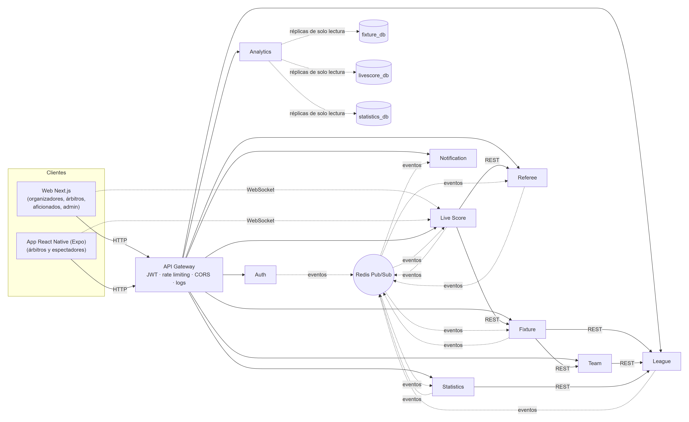

Flujo completo de un partido (README, fuente en `docs/diagramas/flujo-partido.mmd`):

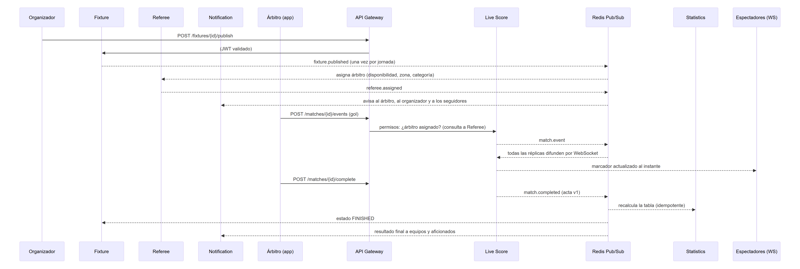

Arquitectura del documento del Momento 2 (M2, p. 3): «Todo pasa por el API Gateway y cada servicio
guarda sus datos en su propia base».

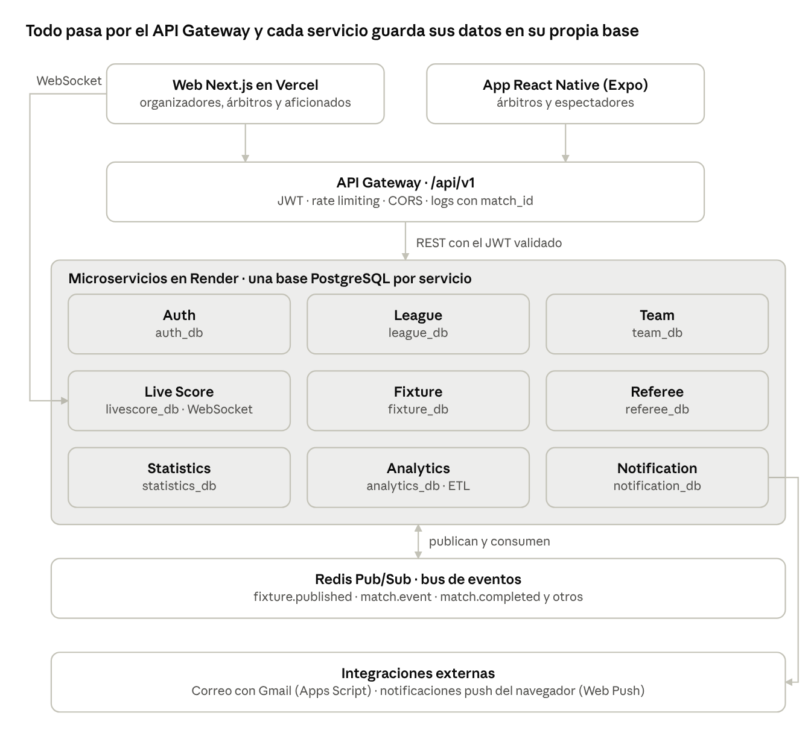

Diagramas del diseño inicial (M1). Muestran el diseño del Momento 1. La implementación difiere en
algunos puntos:

- se agregó Auth Service y el API Gateway es un servicio propio;
- Notification sí tiene base propia;
- el bus de eventos es solo Redis Pub/Sub (el diagrama de secuencia menciona también ActiveMQ Artemis);
- los logs son JSON estructurados con trazas en Redis, sin ELK.

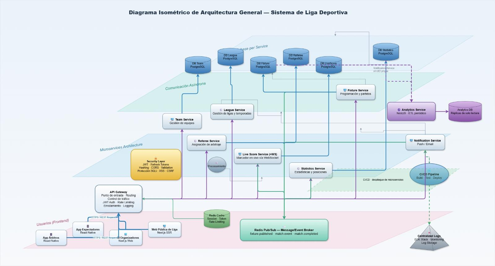

*Diagrama de arquitectura general (M1, sección 1.6, p. 8).*

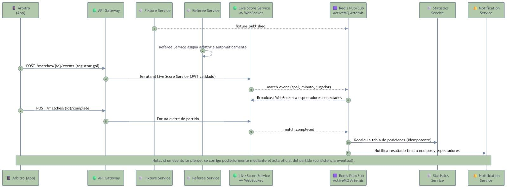

*Figura 2 de M1: diagrama de secuencia del flujo de un partido, desde la publicación del fixture hasta
la notificación del resultado final (sección 4.5, p. 23).*

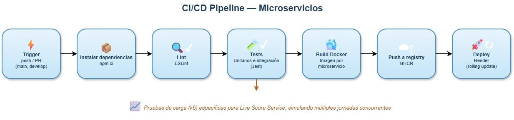

*Pipeline CI/CD por microservicio (M1, sección 7, p. 26).*

### 3. Stack tecnológico

| Capa | Tecnología (versión en el repositorio) | Razón de la elección (documento de arquitectura) |
|---|---|---|
| Lenguaje | TypeScript 5 sobre Node.js 22 | M1, p. 9: «Todos se implementan en NestJS sobre Node.js con Prisma como ORM» (el documento no da otra razón) |
| Framework de los microservicios | NestJS 11 | M1, p. 6: «se estandariza sobre NestJS por consistencia entre servicios»; p. 7: «NestJS aplica inyección de dependencias nativa… lo que facilita las pruebas unitarias con mocks» |
| Acceso a datos | Prisma 6 (ORM y migraciones) | M1, p. 30: «genera consultas parametrizadas por defecto»; p. 28: Prisma Migrate «mantiene un historial versionado de los cambios de esquema» |
| Base de datos | PostgreSQL 16, una base por servicio | M1, p. 21: la base por servicio «garantiza que cada servicio sea completamente autónomo… Esto reduce el acoplamiento entre servicios» |
| Mensajería y caché | Redis 7 (Pub/Sub, caché, rate limiting) | M1, p. 8: eventos «mediante Redis Pub/Sub, desacoplando productores de consumidores»; p. 22: «priorizando la baja latencia sobre la garantía estricta de entrega» |
| Tiempo real | Socket.IO 4 | M1, p. 11: «WebSockets para la difusión en tiempo real hacia espectadores, evitando polling constante desde el cliente» |
| Web | Next.js 15, React 19, Tailwind CSS 4 | M1, p. 27: «con renderizado del lado del servidor (SSR) para posicionamiento SEO de resultados y tablas de posiciones» |
| App móvil | React Native con Expo (SDK 58) | M1, p. 27: «para la app de árbitros y la app de espectadores, con actualizaciones en vivo vía WebSockets» |
| Librerías relevantes | `@nestjs/swagger` (OpenAPI), `class-validator` (validación), `bcryptjs` y `jsonwebtoken` (seguridad), `ioredis`, `prom-client` (métricas), `http-proxy-middleware` y `helmet` (gateway), `web-push`, `pg` (ETL) | M1, p. 30: la validación rechaza «payloads que no cumplan el esquema esperado antes de que lleguen a la capa de datos»; bcrypt, «siguiendo las mismas prácticas estándar de la industria» |
| Contenedores | Docker (imágenes `node:22-alpine`) y Docker Compose | M1, p. 27: «garantizando que el servicio se ejecute de forma consistente en cualquier entorno» |
| CI/CD | GitHub Actions, GitHub Container Registry, gitleaks | M1, p. 26: GitHub Actions «garantiza que el código cumpla estándares de calidad, supere las pruebas definidas y pueda desplegarse de forma segura y automática»; GHCR, «lo que permite versionar imágenes y hacer rollback» |
| Pruebas | Jest 29 (unitarias, integración y cobertura con Istanbul), k6 (carga) | M1, p. 26: k6 «simulando múltiples jornadas jugándose simultáneamente para validar el comportamiento del WebSocket bajo tráfico masivo» |
| Calidad | ESLint 9 | M1, p. 25: «manteniendo un código consistente entre los ocho microservicios» |
| Monitoreo | Prometheus 2.55, Grafana 11 y Grafana Cloud | M1, p. 29: Grafana «con paneles segmentados por liga, categoría y temporada para facilitar el monitoreo en tiempo real durante una jornada» |
| Despliegue | Render (microservicios, PostgreSQL y Redis) y Vercel (web), en planes gratuitos | M1, p. 26: Render despliega «mediante rolling updates… sin interrumpir el servicio»; p. 27: Vercel genera «un preview deployment para validar cambios antes de la fusión» |
| Correo | Gmail a través de Google Apps Script | M2, p. 7: «debido a que Render Free bloquea el envío SMTP» |

### 4. Pruebas, despliegue y monitoreo

Qué se muestra en este momento:

- **Pruebas:** la tabla de A.4 (dos unitarias con mocks y una de integración por servicio), la
  ejecución en local, el CI en GitHub Actions y el informe de cobertura (capturas 6 a 8).
- **Despliegue:**
  - los YAML `ci.yml`, `deploy.yml` y `ci-servicio.yml`, explicados con la tabla de A.5;
  - el cambio que disparó el pipeline hasta el despliegue en Render (captura 9), y la prueba fallida
    que no llega a producción (capturas 10 y 11);
  - los secretos, la protección de `main` y la estrategia de ramas (capturas 12 y 13).
- **Monitoreo:** Prometheus con los 10 targets en UP, el dashboard de Grafana con datos reales y las
  métricas que muestra (capturas 14 a 16).

### 5. Demostración funcional del proyecto

**Preparación:**

1. Unos minutos antes, despertar los servicios:
   `powershell -NoProfile -ExecutionPolicy Bypass -File .\scripts\despertar.ps1`. Debe terminar con
   «Todo despierto».
2. Abrir dos navegadores, o uno normal y otro en privado, para tener dos sesiones a la vez.

**Evidencia del despliegue:** la web en https://sportsleague-cyan.vercel.app, la salida de
`scripts/despertar.ps1` con los 10 servicios en `200` y *Administración → Sistema* con su estado.

Cada paso del guion indica la cuenta, la pantalla, el endpoint que llama la web (a través del API
Gateway), la regla de negocio y los microservicios que intervienen. Los datos son los de la liga de
demostración «Liga Amateur de Montería».

#### Requerimiento 1 · Creación de información: una liga nueva

- **Cuenta:** `organizadora@demo.com` (Sofía Martínez).
- **Pantalla:** *Mis ligas* → *Nueva liga* (`/panel/ligas/nueva`): nombre de la liga, deporte, ciudad
  y descripción → *Crear liga*.
- **Endpoint:** `POST /api/v1/leagues` (League Service).
- **Regla de negocio:** la liga queda *Pendiente de aprobación*. Mientras tanto se puede configurar,
  pero para generar y publicar el calendario debe aprobarla un administrador.
- **Comunicación:** League publica `league.created` y Notification avisa a los administradores.

#### Requerimiento 2 · Consulta de información: la tabla y el calendario de una liga

- **Cuenta:** `aficionado@demo.com` (Camilo Ruiz), que sigue la liga.
- **Pantalla:** *Ligas* → «Liga Amateur de Montería» (`/ligas/[id]`), pestañas *Posiciones*,
  *Calendario*, *Goleadores* y *Disciplina*. Desde el calendario, el partido en vivo de la jornada 7
  (`/partidos/[id]`).
- **Endpoints:** `GET /api/v1/standings/:seasonId`, `GET /api/v1/top-scorers/:seasonId` y
  `GET /api/v1/disciplinary/:seasonId` (Statistics); `GET /api/v1/fixtures/:id` (Fixture).
- **Regla de negocio:** la tabla aplica el reglamento de la categoría: 3 puntos por victoria, 1 por
  empate y desempate por diferencia de gol, goles a favor y enfrentamiento directo.

#### Requerimiento 3 · Actualización de información: reprogramar un partido

- **Cuenta:** `organizador@demo.com` (Laura Gómez).
- **Pantalla:** *Mis ligas* → «Liga Amateur de Montería» → *Calendario* → un partido programado de la
  jornada 8 → *Reprogramar*: fecha, hora o cancha → *Guardar*.
- **Endpoint:** `PUT /api/v1/matches/:id/venue` (Fixture Service).
- **Reglas de negocio:** solo el organizador de la liga o el administrador; solo partidos que no han
  comenzado (`409` si no); la cancha debe ser de la liga (`400` si no).
- **Comunicación:** Fixture consulta por REST la estructura de la temporada a League y los equipos a
  Team, y publica `match.rescheduled`. Referee y Notification lo consumen: el aficionado ve el aviso en
  *Notificaciones*.

#### Requerimiento 4 · Eliminación o cancelación: eliminar la liga del requerimiento 1

- **Cuenta:** `organizadora@demo.com`.
- **Pantalla:** *Mis ligas* → la liga creada en el requerimiento 1 → *Resumen* → *Eliminar liga* →
  confirmar.
- **Endpoint:** `DELETE /api/v1/leagues/:id` (League Service).
- **Regla de negocio:** el organizador solo puede eliminar su liga mientras no esté aprobada. Con una
  liga aprobada, el servicio responde `409`: «Una liga aprobada no se puede eliminar; solicita al
  administrador que la suspenda».
- **Para mostrar una cancelación:** *Calendario* → *Suspender* un partido programado, con su motivo
  (`PATCH /api/v1/matches/:id/status`). Fixture publica `match.suspended`, que consumen Live Score,
  Referee y Notification.

#### Requerimiento 5 · Comunicación entre microservicios: un partido en vivo de principio a fin

- **Cuentas:** `arbitro@demo.com` (Mario Arroyo) en una ventana y `aficionado@demo.com` en la otra.
- **Pasos:**
  1. Árbitro → *Mis partidos* → su partido programado de la jornada 10 → *Confirmar*
     (`PUT /api/v1/assignments/:id/confirm`, Referee) → *Control en vivo*.
  2. Aficionado → abre ese partido (`/partidos/[id]`).
  3. Árbitro → *Iniciar partido* (`POST /api/v1/matches/:id/start`). Live Score pide el partido a
     Fixture y comprueba con Referee que Mario es el árbitro asignado, por REST. Publica
     `match.started` y Fixture pasa el partido a «en curso».
  4. Árbitro → *Gol* en la columna de un equipo → jugador → *Registrar*
     (`POST /api/v1/matches/:id/events`). Live Score publica `match.event` y lo difunde por WebSocket:
     el marcador cambia en la ventana del aficionado sin recargar.
  5. Árbitro → *Finalizar partido* (`POST /api/v1/matches/:id/complete`). Live Score guarda el acta y
     publica `match.completed`: Fixture marca el partido como finalizado, Statistics recalcula la tabla
     con el reglamento que consulta a League y publica `standings.updated`, Notification avisa al
     organizador y a los aficionados, y Referee también lo consume.
  6. Administrador → *Administración* → *Trazabilidad* → ese partido: su recorrido por los
     microservicios, de la publicación del calendario a las notificaciones.
- **Reglas de negocio:** solo el árbitro asignado o el organizador registran eventos (`403` para otro
  árbitro); no se inicia un partido suspendido o finalizado (`409`); después del cierre, solo el
  organizador corrige el acta, que se republica con una versión nueva.
- **Ojo:** este paso usa el único partido programado de `arbitro@demo.com`. Para ensayar antes, usa
  `organizador@demo.com` con otro partido programado: el organizador también puede operar los partidos
  de su liga.

#### Manejo de errores y casos alternos

| Caso | Cómo provocarlo | Resultado esperado |
|---|---|---|
| Error: credenciales incorrectas | En `/login`, `aficionado@demo.com` con una contraseña equivocada, y después un correo que no existe | Auth Service responde `401` con el mismo mensaje en los dos casos, «Correo o contraseña incorrectos», para no revelar qué correos están registrados. La sesión no se abre |
| Error: minuto fuera de rango | `organizador@demo.com` → *Control en vivo* del partido en vivo de la jornada 7 → *Gol* → *Registrar*, sin cambiar el minuto | La web calcula el minuto desde el inicio del partido, y ese partido se inició al cargar los datos de demostración, hace días. Live Score valida que el minuto esté entre 0 y 200 y responde `400`: el evento no se registra. Escribiendo el minuto a mano (por ejemplo, 70) se registra |
| Caso alterno: jugador fuera del rango de edad | `organizador@demo.com` → *Mis ligas* → «Liga Amateur de Montería» → *Equipos* → fichar en un equipo un jugador menor de la edad mínima de la categoría (16 años) | Team Service consulta a League el rango de edad y el jugador queda *No elegible*: no puede jugar. Después se elimina desde la misma pantalla |
